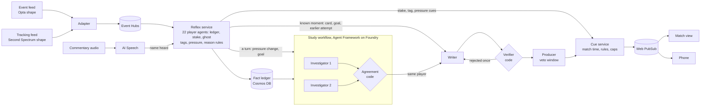

# Tempo: architecture

How Tempo works, what runs today and what is planned for Azure. The concept is in `00-strategy.md`. Commands and file formats are in `tempo/README.md`.

Last rewritten on 11 October 2026, section 14 added on 12 October. "Built" means it runs locally in `tempo/` and is covered by the checks in section 11. "Planned" means designed and not wired. Section 14 says which planned parts are wired once on Azure and must not be built a second way locally first.

## 1. The time budget in a real match

The picture a viewer sees is always behind the data.

| Signal | Delay behind the pitch | Source |
|---|---|---|
| Event data | Under a second to a few seconds | Stats Perform's own claim, not measured by us |
| Tracking data, 22 players and the ball at 25 frames a second | Not published. Assume 1 to 3 seconds | No vendor figure found |
| Broadcast picture | 3 to 12 seconds, up to 38 on some cable | Industry white papers, Super Bowl 2026 measurements |
| Streamed picture | 15 to 60 seconds | Same |

1. **There is more time than "live" suggests.** A stake mark has to be decided about a second after the data arrives, and the viewer's picture reaches that moment several seconds later.
2. **Every viewer is on a different delay, so timing is solved at the screen.** A cue is stamped with the match time it belongs to, and each screen shows it when its own picture reaches that time.
3. **The delay must not be used to peek.** Trigger code may only read data up to the cue's own match time. Section 11 tests this.

## 2. Four paths, by how fast they must be

| Path | Budget | What runs on it | State |
|---|---|---|---|
| Reflex | Under 100 ms a tracking frame | The player layer (ledgers, the stake model, the ghost at each goal), rare-number tags, duel counts, momentum, pressure changes | Built. 0.38 ms a frame at the 95th percentile, no language model |
| Decision | Under 500 ms | Whether a moment is worth showing, on which screen, and whether it replaces what is there | Built as rules. A decision model behind the same interface is planned |
| Writing | 3 to 10 seconds, done before the next pause | Closest-attempt search, the sentence for a known kind of moment, the check, the Arabic line | Built with templates. A model call through Foundry is planned |
| Study | One to three minutes, shown at the next long pause, half time or full time | Two investigators working out why the match turned, and the agreement gate | Tested as a spike. Section 6 |
| Offline | Before the match | Season baselines, each player's usual, the kick-off marks | Built on a six-match season. 380 planned |

A goal is followed by 20 to 40 seconds of celebration before the replay airs, which is why the laid-over replay can sit on the writing path.

## 3. The data, in production shapes

The generator emits the two shapes a Premier League production would supply, so moving to a real match means changing the source and nothing else. Field names come from the open-source `kloppy` parsers, since the vendors' specifications are not public.

| Feed | Supplier in production | What is public |
|---|---|---|
| Events | Opta (Stats Perform), through Football DataCo | Collected by analysts at the venue. Live feeds claimed sub-second |
| Tracking | Genius Sports (Second Spectrum), in every Premier League ground | Positions of every player and the ball. Skeletal tracking built for semi-automated offside |
| Picture and commentary | Premier League Studios from 2026/27 | Graphics on Vizrt. A "Data Zone" mode already draws speeds and names |

**Event, Opta shape.** One record per event, sometimes corrected afterwards. Type 43 marks a deleted event, and anything shown that rests on it has to be withdrawn.

```json
{"id": 2518734411, "typeId": 17, "periodId": 2, "timeMin": 47, "timeSec": 12,
 "contestantId": "t_har", "playerId": "p_har_6", "outcome": 1, "x": 58.3, "y": 49.1,
 "qualifier": [{"qualifierId": 31}]}
```

**Tracking frame, Second Spectrum shape.** One line per frame, in metres from the centre spot. `live` is false when the ball is out of play. Player IDs match the event feed's, so the two join without a lookup table.

```json
{"frameIdx": 70812, "period": 2, "gameClock": 132.48, "live": true, "lastTouch": "away",
 "ball": {"xyz": [12.4, -3.1, 0.2], "speed": 6.8},
 "homePlayers": [{"playerId": "p_nor_10", "number": 10, "xyz": [9.8, -2.7, 0], "speed": 5.9}],
 "awayPlayers": [{"playerId": "p_har_6", "number": 6, "xyz": [14.9, -1.2, 0], "speed": 2.1}]}
```

**What depends on production and not on data:**
- **A "replay on air" signal.** Neither feed carries it. It is known only in the gallery. Fallback: a rule such as 25 seconds after a goal.
- **The clock mapping** between data and the viewer's picture, carried in the stream as timed metadata.
- **A graphics adapter** from the cue format to Vizrt template fields.
- **Commentary audio**, which exists inside production.
- **A season archive** from the league, for baselines and for searching earlier attempts beyond one match.

## 4. The flow



Today every store and bus in this diagram is a local stand-in behind the same interface: a SQLite ledger for Cosmos DB, an in-process bus for Event Hubs and Web PubSub, the generator's commentary lines for AI Speech, and templates for the model. The stand-ins are frozen as they are. Section 14 lists what replaces each one and what must not be built in between.

## 5. Each part

| Part | File | Today | On Azure |
|---|---|---|---|
| Data contracts | `contracts.py` | Events, tracking frames, facts and cues, with deterministic IDs | The same |
| Match generator | `generator/` | A seeded match with a physical ball, a planted story and commentary lines | Replaced by the real feeds |
| Reflex service | `reflex.py` | One process holding the match state, snapshotted every 30 seconds of match time | A Container App, one replica per match, reading Event Hubs from a stored offset |
| Stake model | `stake/` | A 98,433-weight network, final | The same file |
| Closest earlier attempt | `twin.py` | Search over this match's attacks in memory | Azure AI Search over the season |
| Fact ledger, cues, checkpoints | `ledger.py` | SQLite | Cosmos DB, partitioned by match |
| Cue service | `cues.py` | Producer rules, slots, cooldowns, caps, an audit line for everything shown or held back | A Container App, out through Web PubSub |
| Writing and verifier | `agents.py` | One sentence per language from templates, a proof list as data, the verifier, a breaker and a fallback | A writer model through `FoundryBackend`. The verifier stays code |
| Ghost and reason rule | `ghost.py`, `reflex.py` | One small network fitted on six generated matches (`python3 -m tempo.ghost`), run at every goal. The rule names a reason when three instruments agree | The same |
| Study workflow | `spike/agents_test/` | A test harness with blind cases and scoring, not in the pipeline. It is not wired into the local pipeline at all | Built once, in Microsoft Agent Framework on Foundry: two investigators and the agreement gate. The harness's cases and scorer are reused |
| Listener | `listener.py` | Reads commentary lines as text. No local speech recognition, by decision | Azure AI Speech, real time, with the squad names as its phrase list |
| Season | `season.py` | Six generated matches | 380 generated matches, or the league archive |
| Views | `ui/` | Static pages reading a finished run. `server.py` can replay a run's cues as a stream | The same pages subscribed to Web PubSub |

**Facts and cues.**
- A fact: `{fact_id, match_id, match_time, kind, subject, value, unit, percentile, source_event_ids, version}`.
- A cue: `{cue_id, match_id, match_time, valid_for, screen, form, when, priority, payload, fact_ids, status}`.
- IDs are hashes of what the thing is and when. Running the same stretch of match twice gives the same IDs, so recovery cannot show anything twice.
- A correction withdraws a fact, and every cue resting on it is withdrawn from the screens.

**Producer rules in the cue service.** Each form can be switched off. One item per television slot. At most two faint stake cards at once and 20 full cards a match. A number tag at most every 90 seconds, and a duel count at most every 90 seconds, each on its own clock (until 12 October they shared one, and a duel count silenced the demo's rare shot speed).

## 6. The agents: one design, chosen by test

Decided on 11 October after three rounds of research and the tests in the table below. It replaces "one agent for each team" and the first version of this section.

### The design

**Layer 1. Twenty-two player agents, as models.** In football research "multi-agent" means the players: each one is modelled as an agent with his own state and his own policy. Tempo gives every player three things and publishes them to the shared ledger on every frame:
- **A ledger:** cards, duels, running against his usual. Built.
- **A stake score:** the chance he makes a challenge in the next second and a half. Built, section 7.
- **A ghost:** where an average defender would be now, given where he stood two seconds ago and how the play has moved. Built (`tempo/ghost.py`), fitted on generated matches, and run at every goal.

This is the line of work that runs from ghosting (Le, Carr, Yue and Lucey, 2017) through NFL Ghosts (2024) to this year's action valuation of all 22 players. One of the ghosting authors is now chief scientist at Stats Perform, which owns Opta, the league's official insights provider.

**Layer 2. Rules, for a reason whose shape is known.** The reason behind a goal is named by code when three independent instruments point at the same player: the earlier attempt's differing defender, the defender standing furthest off his ghost at the goal, and a yellow card from before it. What is shown is the facts side by side. No "because". Built in the reflex service. When the three do not agree, nothing is claimed and the miss is logged.

**Layer 3. The desk, for a turn nobody scripted.** Language agents on Microsoft Agent Framework. It runs for one to three minutes and reports at the next long pause, half time or full time. Tested as a harness, not in the pipeline.

| Step | Kind | What it does |
|---|---|---|
| Investigator, two copies run at once | Agent with code tools | Each works alone on the same question: why did the match turn? It reads the match record and the player layer up to that moment, writes and runs its own analysis, rules out alternatives, and returns a typed verdict or "no clear cause" |
| Agreement gate | Code | Both verdicts must name the same player. Otherwise nothing is said, and the miss is logged |
| Writer | One model call | Gets the verdict only, never the investigators' working, and writes a line and a label |
| Verifier | Code | Every number, name and minute must match a fact. One rewrite, then the template |
| Producer | Person | A veto window before a new cause goes on a card |

The same two investigators have a second job: before a rule from layer 2 is worded as a cause, they are asked whether the data supports it. If they do not both agree, it stays as facts side by side.

A verdict is a typed object: `{cause_type, team, player_id, onset_minute, evidence[], alternatives_ruled_out[], confidence}`. Every hand-off is a typed object that code validates. Agents never talk to each other. They coordinate through the ledger.

### The tests behind it (11 October)

Scripts are in `spike/ghost/` and `spike/agents_test/`, results in `artifacts/ghost_*.json` and `artifacts/agents_*.json`. The investigators were Claude Sonnet run headless, each in its own folder with no sight of the answers. None of the 42 runs opened a file outside its folder.

| Question | Test | Result |
|---|---|---|
| Can a ghost be learned from seven matches? | Leave one match out, 2 seconds ahead | Median error 1.40 m, against 2.06 m for assuming he keeps his pace and 4.57 m for assuming he stands still. At 3 seconds: 2.30 against 4.01 and 6.53. Steady across all seven matches |
| Does the ghost find who stood off at the planted goal? | Five seeds of the demo story, ghost fitted on generated matches | Skoles is the furthest off his ghost in 5 of 5, by 4.4 to 4.7 m |
| Can the ghost alone say it was unusual? | The same number at 76 ordinary shots | No. The largest stand-off at an ordinary shot has a median of 3.0 m and a 90th percentile of 5.0 m, so 4.5 m is about the 83rd percentile. An unplanted goal scored the same |
| Does a fixed rule over three instruments name the planted reason? | Eight goals: four planted, four not | 8 of 8 right. Nobody named at the four ordinary goals |
| Does an investigator find the same reason from raw data? | The same eight goals, two runs each | 0 of 8 planted runs. No false cause in 7 control runs |
| Does giving it the instruments help? | The same, with ghost, earlier attempt and ledger supplied | 0 of 7 planted runs. No false cause in 8 control runs. Runs were about 15 in 100 shorter and cheaper |
| Does an investigator find a sustained change? | Five matches from a simpler simulator: a full back who fades, a substitute who presses, a booked midfielder who stops tackling, two with nothing | 3 of 6 planted runs right, one run named the wrong player, 4 of 4 control runs said no clear cause. An earlier run of the same matches with a smaller model was right in 9 of 10 |
| Does a second investigator with the gate earn its place? | Every pair above | The gate removed the one wrong player named in 50 runs. It also lost one true finding, where only one of the two runs named the substitute |
| Should the investigator write for air? | Its own one-sentence summaries | 14 of 30 contained a number it had computed itself, which no fact in the ledger backs. So the writer gets the verdict only, and the verifier checks the line |

### What the tests changed

- **The reason at a goal is rules, not agents.** A single event cannot be proven as a cause from data, and the investigators said exactly that, with numbers: his stand-off was inside the ordinary range, and in at least two of the four seeds his challenge rate did not fall after the card. They were right. So Tempo shows the facts side by side, and the old claim "held off on a yellow", which asserted a cause, is gone from the code.
- **The ghost is an instrument and not a detector.** It says who. It needs the other two instruments to say whether.
- **Two investigators stay, on thin evidence.** One wrong attribution in 50 runs, removed by the gate. If a larger test shows no gain, this drops to one investigator.
- **The team agents are gone from the code,** along with the two depths of sentence. A director agent, debate and manager-led orchestration were never built. Nothing tested or found supports any of them.
- **What a viewer who wants more gets is the proof, not a longer sentence.** Each line carries a short list of the facts behind it, each with its number, in English and in Arabic with names in Arabic script.

### Limits of these tests

- Small numbers throughout: six planted runs for sustained causes, one wrong attribution.
- The current generator plants only one kind of cause that moves the match, a single event. Sustained causes were tested on an older, simpler simulator. A fading full back and a midfielder who stops tackling were then planted in the current generator (`SustainedStory`) and measured on six seeds: the change shows in the player's own numbers and does not move the match, because full backs here are rarely run at. So the desk's question has no true case in the current generator yet.
- The ghost that found Skoles was fitted on generated matches. The ghost fitted on real matches did not single him out on generated football, where defenders stand closer to the ball than real ones do.
- The instruments file described two near-identical attacks as "0.4 m average gap". Two investigators read that as a weak signal, so the instruments may have been undersold.
- The test subjects ran on Claude Sonnet through a command line, not on a Foundry deployment.

### Against the Multi-Agent prize

| What the judges assess | Tempo's answer | State |
|---|---|---|
| Specialized agents with distinct roles | 22 player agents with a ledger, a stake score and a ghost. Investigators with code tools. A writer that sees only the verdict | Player layer built. Investigators tested as a harness |
| Coordination through shared state | Everything goes through the fact ledger | Built |
| Effective hand-offs | Typed objects that code validates before the next step | Built for the writing path |
| Recovery from failures | Checkpoint after each step, breaker, template fallback, same cue IDs after a restart | Built and tested for the writing path |
| An outcome one agent could not achieve as effectively | One language model cannot compute where 22 players should stand. The gate removed the one wrong cause a single investigator named | Measured, on small numbers |

### What stays from the first design

- **Read-only tools scoped by who is calling,** and refused for anything after the moment in question. Tested today.
- **The verifier checks numbers and names by position.** The facts dictate which numbers and which players a sentence must contain, and in what order. Checking only that each one came from some cited fact was not enough, twice: a planted "36 m" passed because 36 was another fact's percentile, and on 11 October a planted "Maro scores" passed because Maro was the subject of the goal's ghost fact.
- **Every run is fresh,** with a small packet of facts. The match's memory lives in the ledger.

## 7. The stake model

A small convolutional network over two seconds of history (10 time steps, 20 inputs each). It answers one question for one defender: will he make a challenge in the next second and a half. For a booked player, the answer drives the card on him: faint above 0.02, full above 0.19.

Trained and evaluated on seven DFL open matches (Bundesliga, 2022/23, 25 Hz tracking, 1,099 logged challenges, 66 by booked players after their card). Every figure comes from a model that never saw the match it is scored on, with both thresholds chosen on the other six matches by rules fixed in advance (`python3 -u -m tempo.stake.train`).

| | Faint card | Full card |
|---|---|---|
| On him at contact | 88 in 100 (95% interval 80 to 95) | 30 in 100 (20 to 41) |
| On half a second or more before | 80 in 100 | not recorded |
| Median lead where on | 1.8 s | 0.7 s |
| Appearances a match | 106 on average (35 to 218) | 11 on average (3 to 27) |

- **Ranking:** ROC AUC 0.881, average precision 9.9 times chance. Distance to the ball alone gives 0.708.
- **Calibration error 0.0015,** so a score can be read as a chance. That is what lets the card's strength follow the score honestly.
- **Was the stake real when the card showed?** Measured at earlier thresholds (0.05 and 0.20): in 59 in 100 faint appearances and 75 in 100 full ones he could have gone in. 5 in 100 faint appearances were empty and no full ones.
- **It does not give the result away.** Fouls are no more common among covered challenges than among all challenges.
- **Speed:** 1.4 ms for all 22 players on one CPU thread.

**What a reader should discount.** Seven matches, one league, one season, so the intervals are wide. The load swings six-fold between matches with the number of bookings, which is why the cap is on what shows at once. The label is a human logger's judgement. A full card above 50 in 100 would need information that positions do not hold.

**What was tried and set aside.** No rule or model could forecast a booked player's challenge a full second ahead more than about one time in five. A version that used the broadcast delay to place the card worked and was dropped, because it reads ahead.

## 8. The closest earlier attempt

After a goal, the attack is compared with every earlier attack in the match that did not score.

- Two attacks are compared from their start (the last restart or change of possession) over the first 1.6 seconds.
- They must be within 4 metres a player on average, and closer than 95 in 100 pairs.
- The difference reported is the first defender to stand 3 metres or more differently while within 12 metres of the ball.
- If nothing is close, there is no claim and the replay is plain.

**On real football there was no true twin.** In 122 shots across the real matches the closest pair was 8.3 metres apart a player. So the claim is "closest earlier attempt", which is true of any match, and the close pair in the demo is planted by the storyline and labelled as planted. A league archive would make close pairs far more likely.

## 9. The pressure change

Added on 11 October. Once a second the reflex service records which half the ball is in while play is live. Four times a minute it compares the last five minutes with the five before. A change is reported when a team has at least 70 in 100 of the play in the other half and at least 30 more than before, at most once every ten minutes.

- **The fact** carries both shares, the window and how many times the team won the ball in the other half.
- **On screen:** a label at the next stoppage, a checked sentence on the phone, and a place among the full-time cards after the goals. The momentum strip shows it only as the curve changing side. The triangle that marked each change on the strip was removed on 12 October because the strip held more than a fan could read.
- **In the demo match** it fired at 15, 50, 71 and 84 minutes. Two of them, Northgate with 72 in 100 against 26 and with 75 against 37, are pinned on the full-time chart beside the goal.
- **Limit:** it measures where the play is. It does not measure pressing itself, which would need distances between players, and it says nothing about cause.

## 10. The generator

The ball is a physical object. It rolls and slows on the turf, flies and bounces under gravity, and changes pace only at someone's feet. A dribbler keeps it just ahead with small touches, a pass is struck from within reach, and a receiver has to get to the ball. Nothing is moved by hand, including at stoppages.

**Kick-offs follow the law** (12 October): the two men at the ball are both from the side taking it, everyone is in his own half, and the other side stays out of the centre circle. Before this, one striker from each side stood at the centre spot. The fix changed the starting positions, so the whole generated match changed with it: it now ends 1-0 (Roonay, 72').

**Players have bodies** (added 11 October, after Mohamed said players meeting looked like beads). Before this, two players passed within 0.3 m of each other in 66 of 100 challenges, and nothing happened to either of them afterwards. Now:
- Two players cannot stand in the same place. Their centres stay 0.7 m apart, and a man who runs into another loses the speed he was closing at.
- A challenge does something to the man who loses it. Tackled, he is knocked off his stride. Beaten, the defender is left standing. Fouled, he goes down and stays down for two to three seconds.
- The view draws this as it is: markers in contact overlap with the nearer man on top, both give for an instant at the moment of contact, and a fouled player's marker shrinks and loses its facing wedge while he is down.

**Motion that cannot happen** (`python3 -m tempo.eval.physics demo`):

| Measure, demo match | Value |
|---|---|
| Ball jumps over 2 m in one frame | 0 |
| Player jumps over 1 m in one frame | 0 |
| Closest two players ever get | 0.69 m |
| Frames with two players under 0.5 m apart | 0 |
| The man tackled: speed before, then after | 2.8, then 1.1 m/s |
| The defender beaten: speed before, then after | 2.9, then 0.8 m/s |
| The man fouled: speed before, then after | 2.8, then 0.1 m/s |
| Dribbling: ball to the man on it, median | 0.58 m |
| Ball changes pace on the turf with nobody near | 0 frames |
| Stoppages | 129 |

**Against real football** (`python3 -m tempo.eval.realism data/dfl-cache 31 32`): 9 of 14 measures within 25%. The figure moves between runs.

| Measure | Real | Generated |
|---|---|---|
| Metres a minute in play | 151.1 | 167.0 |
| Share of time above 5.5 m/s | 4.4 in 100 | 5.3 in 100 |
| Share of time above 7 m/s | 0.84 in 100 | 0.54 in 100 (outside) |
| Ball to nearest defender: p25, median, p75 | 2.8, 5.1, 8.7 m | 2.8, 5.1, 8.1 m |
| Ball in play, minutes a match | 52.7 | 58.4 |
| Defending challenges a match | 157 | 192 |
| Share of defender-moments followed by a challenge | 1.45 in 100 | 2.18 in 100 (outside) |
| Stake model ROC AUC | 0.913 | 0.804 |
| Full cards per 100 player-minutes, if everyone carried a card | 22 | 34 (outside) |

The distance from the ball to the nearest defender now matches real football, which it did not before bodies. Generated players still sprint less than real ones, and they go into more challenges, so the stake card fires more often on generated matches than it would on real ones.

## 11. The checks

`python3 -m tempo.eval.checks`, results in `artifacts/checks.json`. 14 of 14 pass on the run of 12 October.

| Check | Result |
|---|---|
| No reading ahead | The match was cut at 35% and at 80% and rerun with the future removed. The cues up to the cut are identical: 129 of 129 and 369 of 369 |
| Recovery | The process was stopped at 30% and at 77% and resumed from the last checkpoint. 454 cues, same IDs, same order |
| The planted story is found | Booking at 49.5'. Closest earlier attempt at 12.4' (planted 12.2'). First relevant difference: Skoles, by 7.0 m |
| No stake card before the booking | First card on Skoles at 50.1' |
| Verifier accepts what the pipeline wrote | 10 of 10 sentences, English and Arabic |
| Verifier rejects planted errors | 141 of 141: wrong numbers, wrong names in either script, overclaims, changed Arabic digits |
| Agent tools refuse out-of-scope reads | 3 of 3. No fact leaked from after the moment |
| A withdrawn booking | 4 cues withdrawn, no card on him afterwards, and the later sentence no longer cites a booking, because the reason rule loses its third instrument |
| Tracking survives the feed shape | 200 frames written in the Second Spectrum shape and read back |
| Speed | Reflex path 0.38 ms a frame at the 95th percentile. The slowest frame, 12 ms, is the ghost at a goal. A match runs in about 20 seconds |
| Full cards within the cap | 14 issued against a cap of 20. The model wanted 14 |

**Designed and not yet run, and local:** a booked player standing still, a header, a wall at a free kick, a booking that arrives late, a tracking drop. None needs a model or a service.

**Designed and not yet run, and waiting for Azure:** the breaker under a failing model and the cost caps. Both live in the workflow's middleware and mean nothing against templates.

## 12. When something is slow or down

**Rule: the screen degrades to silence or to a template. It never waits and never shows something unchecked.**

| Path | Time allowed | When it runs out |
|---|---|---|
| Reflex | 100 ms | The cue is dropped. A late stake mark is worse than none |
| One writer call | 4 seconds | The template |
| The study workflow | 3 minutes | Nothing is said about a cause. The card uses facts only |
| Whole workflow for a replay | 10 seconds from the goal | A plain replay with the template label |
| Half-time and full-time cards | 30 seconds | Cards built from templates |

- **A breaker around the model.** Three failures inside 60 seconds open it for 2 minutes, and the template path is used. Built.
- **Tracking gap over half a second:** stake triggers switch off until two seconds of clean frames arrive. Planned.
- **Event feed gap:** no card mark fires, because a booking or a correction may be missing. Planned.

## 13. Cost for a match

Estimates until measured on Azure.

- **About 20 moments a match reach the writer:** kick-off, half time, full time, and the goals, bookings and pressure changes. Stake marks, tags and the commentary cue reach no model.
- **About five turns a match reach the study workflow,** each with two investigators. In the tests one investigator run took 14 tool calls, about 90 seconds and about 0.40 dollars on Claude Sonnet, so about 4 dollars a match. A Foundry deployment will differ.
- **About 10,000 input and 2,000 output tokens a moment** with one extra language, so about 200,000 in and 40,000 out a match. The system prompt and team profile sit first, so most of the input is cached.
- **Caps, planned in the workflow's middleware:** 40 moments, 400,000 input and 80,000 output tokens. At the cap the match finishes on templates.

## 14. On Azure: what is wired once there

Decided on 12 October. Mohamed's plan is to finish the product locally and then stage it on Azure in one block of a day or two. So the rule is:

**A local stand-in exists to keep the pipeline running and testable. It is never upgraded. Anything whose real form is an Azure service is built once, on Azure.** Building a better local version first is double work, and what it proves does not carry over.

The services: Container Apps, Event Hubs, Cosmos DB, Blob Storage, AI Search, Foundry models with Agent Framework, AI Speech, Web PubSub and Application Insights. Static Web Apps for the pages, `azd` with Bicep to deploy, managed identity everywhere.

### Wired once on Azure

| Part | The stand-in today, frozen | What is wired on Azure | Not to be built locally first |
|---|---|---|---|
| Speech recognition | `listener.py` reads the generator's commentary lines as text. In the film, the spoken line's word times are an estimate written by `tools/film_music.py` | AI Speech in real time with both squads as its phrase list. Run the film's commentator clip, and a longer stretch with the crowd mixed in, through it once: that gives the real word times (same `speech` field in `tempo-theme.json`) and the latency figure | A local speech-to-text model. Considered and dropped on 12 October |
| The writer | Templates, which are also the designed fallback and stay | A Foundry model through `FoundryBackend`, today a stub that raises. The verifier meets a real model for the first time here | Another provider's model, or a local model, behind the writer |
| The Arabic line | Arabic templates | The same writer call, re-checked by the verifier | A separate translation model or service |
| The study workflow | The test harness in `spike/agents_test/`. Its cases, blind folders and scorer are reusable. Its runner, a command-line model, is not | Agent Framework on Foundry: two investigators with code tools, the agreement gate, checkpoints. The larger test is run here, because results from one model do not transfer to another | Wiring the desk into the local pipeline on a command-line model. A second round of the harness on any model other than the Foundry deployment |
| The decision step | Rules | Rules. If Microsoft-Decision-1 is available it sits behind the same interface and is measured before any claim | A local decision model |
| The bus | `LocalBus`: publish, read from an offset, size | An Event Hubs adapter with the same three methods, and a feeder that plays the generated match into it at real-time speed | A local broker, or a local real-time streamer |
| Ledger, cues, checkpoints | `Ledger` on SQLite | Cosmos DB, partitioned by match | Another local database, or tuning the SQLite one |
| Push to the screens | Static pages reading a finished run. `server.py` replays cues as a stream | Web PubSub, with each screen releasing a cue by its own picture's match time | Local websockets, or extending `server.py` |
| Earlier attempts across a season | `twin.py` searches this match in memory | AI Search over the season | A local index over the season |
| Breaker under a failing model, token and cost caps | The breaker is built and tested around templates. The caps are designed | The workflow's middleware, measured on the Foundry deployment | Simulated model failures or cost sums beyond the check that exists |
| Latency, recovery and cost figures for the pitch | Local figures exist: 0.35 ms a frame, 454 cues identical after a stop | Measured on Azure. Recovery is filmed by stopping a replica | More local benchmarks. Filming a local recovery |
| Tracing | An audit line in the ledger for everything shown or held back | Application Insights | A local dashboard |
| Deployment and identity | None | `azd` with Bicep, managed identity | Containers or compose files for local use |

### Not double work: finished locally first

These do not change when the services arrive, so doing them now loses nothing.

- **Wide attacks in the generator,** so that a lasting change by one player can turn a match. The study workflow has no true test case without it.
- **The 380-match season.** It is generated here whatever happens. Azure only stores and indexes the result.
- **The local adversarial cases** in section 11, and the two planned degradation rules in section 12 (tracking gap, event feed gap).
- **The personalization mode** and the decision on control vs chaos (`00-strategy.md` section 8).
- **The evaluation gate in GitHub Actions.** It runs the same checks wherever the code runs.
- **The film, the video, the README for judges and the pitch.** Only the Azure architecture shot and the recovery on camera wait.

### What the seams look like today

Checked in the code on 12 October. Each stand-in is one class or one function with a small surface, so wiring is a new adapter and not a rewrite: `Listener.mentions(text)`, `LocalBus` (three methods), `Ledger` (facts, cues, checkpoints, audit), `LocalBackend` beside the `FoundryBackend` stub, and `twin.py`'s search. Two things have no seam yet and are written new on Azure: the feeder that plays a match into Event Hubs in real time, and the study workflow itself.

### To settle on the first Azure day

1. Which region has all of these.
2. Whether Foundry hosted agents are generally available on the subscription. If not, the same workflow runs in a Container App.
3. Whether the Agent Framework version installed has the fix for Cosmos checkpoints (issue 8874). If not, use the file store.
4. How fast AI Speech returns a recognised name. No published figure was found on 12 October, so this is measured, not looked up. The free tier covers 5 hours of real-time recognition a month.
5. Whether Microsoft-Decision-1, announced on 9 October, is available.

**Left out:** Functions, Logic Apps, Azure Translator, Stream Analytics and Fabric. The logic is custom code, the data is small, and translation is a model call that the verifier re-checks.

## 15. Hackathon against a real match

| Part | Hackathon | Real match |
|---|---|---|
| Data | The generator, in production shapes at real-time speed | The Opta and Genius feeds through the same adapter |
| Replay on air | A rule after a goal | A signal from the gallery |
| Picture | The marker view | The broadcast, with match time carried in the stream |
| Commentary | The generator's lines as text. On Azure, a generated clip of the line (an invented voice, no real commentator) through AI Speech | The live commentary feed |
| Season memory | Generated matches | The league's archive |

Nothing in the middle changes.

## Sources

- Stats Perform on feed latency: https://www.statsperform.com/stats-perform-faqs-apis-and-data-delivery/
- Super Bowl 2026 picture delays: https://www.streamtvinsider.com/technology/nbcus-peacock-performs-super-bowl-lx-2026-streaming-latency
- Broadcast and streaming delay ranges: https://www.quortex.io/wp-content/uploads/2022/05/WhitePaper-the-truth-about-low-latency.pdf
- Stats Perform and Football DataCo: https://www.svgeurope.org/blog/news-roundup/stats-perform-expands-official-media-data-partnership-with-football-dataco/
- Genius Sports and Football DataCo: https://www.geniussports.com/newsroom/genius-sports-and-football-dataco-extend-exclusive-official-data-partnership-through-2029/
- Data Zone: https://www.geniussports.com/newsroom/premier-league-productions-partners-with-genius-to-deliver-ground-breaking-premier-league-data-zone/
- kloppy parsers (field names): https://github.com/PySport/kloppy
- DFL open dataset (Bassek et al. 2025, CC BY 4.0): https://doi.org/10.6084/m9.figshare.28196177
- Agent Framework checkpoints: https://learn.microsoft.com/en-us/agent-framework/workflows/checkpoints
- Cosmos checkpoint issue: https://github.com/microsoft/agent-framework/issues/8874
- Agent Framework 1.0: https://devblogs.microsoft.com/agent-framework/microsoft-agent-framework-version-1-0/
- Microsoft Reactor series for the hackathon: https://developer.microsoft.com/en-us/reactor/series/s-1709/
- Microsoft on agent orchestration patterns: https://learn.microsoft.com/en-us/azure/architecture/ai-ml/guide/ai-agent-design-patterns
- Anthropic on its multi-agent research system: https://www.anthropic.com/engineering/built-multi-agent-research-system
- Multi-agent debate evaluations: https://proceedings.mlr.press/v235/smit24a.html and https://arxiv.org/html/2502.08788v2
- Why multi-agent systems fail: https://arxiv.org/html/2503.13657v3
- Ghosting: https://authors.library.caltech.edu/records/74xh3-ysx85
- NFL Ghosts: https://arxiv.org/abs/2406.17220
- Action valuation of all 22 players: https://arxiv.org/abs/2610.05961
- PGA TOUR's agent pipeline: https://aws.amazon.com/blogs/media/accelerating-sports-content-creation-usingagentic-ai-pga-tour
- Stack research: `research/04-microsoft-stack-broadcast.md`
