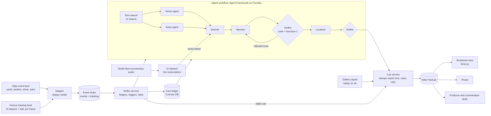

# Tempo: architecture

Draft of 10 October 2026 for Mohamed to review. Nothing here is built. It answers one question: how does what the mock-up shows work on a real match at real data speed, and with which tools. The concept is in `00-strategy.md`.

## 1. The time budget in a real match

The picture a viewer sees is always behind the data.

| Signal | Delay behind the pitch | Source |
|---|---|---|
| Event data (goal, card, pass) | Under a second to a few seconds | Stats Perform says sub-second for its live feeds. A customer says "within seconds". Vendor claims, not measured by us |
| Tracking data (22 players and the ball, 25 times a second) | Not published. Assume 1 to 3 seconds | No vendor figure found |
| Broadcast picture (satellite, cable) | 3 to 12 seconds, up to 38 on some cable | Industry white papers, Super Bowl 2026 measurements |
| Streamed picture | 15 to 60 seconds | Same |

Two things follow.

1. **We have more time than "live" suggests.** A stake mark has to be decided about one second after the data arrives, and the viewer's picture reaches that moment several seconds later. Even a model call of two or three seconds fits before most viewers see the play.
2. **Every viewer is on a different delay, so timing has to be solved at the screen.** A cue is stamped with the match time it belongs to, and each screen shows it when its own picture reaches that time. If we sent cues "now", a streaming viewer would see the card over Stahl half a minute before he moves.

The second point also creates a temptation. With 30 seconds of lead the system could see whether a tackle became a foul before showing the mark. The trigger code is therefore only allowed to read data up to the cue's own match time.

## 2. Four paths, by how fast they must be

| Path | Budget | What runs on it | Model calls |
|---|---|---|---|
| Reflex | Under 100 ms per tracking frame | Player ledgers, the stake model, speed tags, danger windows, duel counts, line of sight, momentum | No language model. One small network for the stake, about 98,000 weights, 1.4 ms for all 22 players on one CPU thread |
| Decision | Under 500 ms | "Is this worth showing, on which screen, does it replace what is there" for anything the rules do not settle | One typed decision (Microsoft-Decision-1 or a small scorer) |
| Writing | 3 to 10 seconds, finished before the next pause | Twin search, the two team agents, the Director's choice, the sentence, the check, translation | Several |
| Offline | Before the match | Season baselines, each player's usual, attack vectors for twin search, the kick-off marks | Few |

A goal is followed by 20 to 40 seconds of celebration before the replay airs, which is why the twin replay can sit on the writing path.

## 2b. The data that exists in production, and its shape

This replaces "vendor feed later" with names. It describes the Premier League as far as public sources show on 10 October 2026. Field names come from the open-source `kloppy` parsers for these feeds, since the vendors' own specifications are not public.

### Who supplies what

| Feed | Supplier | What is public about it |
|---|---|---|
| Event data | Opta (Stats Perform), exclusive official media data for Premier League and EFL through Football DataCo, extended in December 2024 | Collected by analysts at the venue with AI support. Stats Perform says its live feeds are sub-second |
| Tracking data | Genius Sports (its Second Spectrum and GeniusIQ systems), official tracking partner to Football DataCo, installed in every Premier League ground | Up to 30 cameras a ground, some at 100 frames a second. "Sub-second positional data on every player and the ball." Skeletal tracking, with up to 10,000 surface points a player, built for semi-automated offside |
| Broadcast picture and commentary | Premier League Productions, moving in-house as Premier League Studios from 2026/27 | Graphics on Vizrt, operated by AE Live. A "Data Zone" mode with Genius already draws speeds and player names |
| Betting data | Genius Sports | Not relevant to us |

### Event feed (Opta shape)

One record per event, pushed as it is collected, and sometimes corrected afterwards.

```json
{"id": 2518734411, "typeId": 17, "periodId": 2, "timeMin": 47, "timeSec": 12,
 "contestantId": "HAR", "playerId": "p_stahl", "outcome": 1, "x": 58.3, "y": 49.1,
 "timeStamp": "2026-10-24T15:52:12.480Z",
 "qualifier": [{"qualifierId": 31}]}
```

- **Types we depend on:** pass 1, take on 3, foul 4, corner awarded 6, tackle 7, interception 8, shots 13 to 16 (16 is a goal), card 17, player off 18 and on 19, start and end of a delay 27 and 28, period start 32 and end 30, formation change 40, aerial 44, challenge 45, ball recovery 49.
- **Card qualifiers:** 31 first yellow, 32 second yellow, 33 red.
- **Coordinates:** 0 to 100 on each axis, always as if the team in possession attacks left to right.
- **Corrections:** type 43 marks a deleted event, and events can be re-sent with changes. Anything we showed that rests on a deleted event has to be withdrawn.
- **Not in this feed:** pressures, positions of players off the ball, speeds.

### Tracking feed (Second Spectrum shape)

One line per frame, with a separate metadata file for the match.

```json
{"frameIdx": 70812, "period": 2, "gameClock": 132.48, "live": true, "lastTouch": "away",
 "ball": {"xyz": [12.4, -3.1, 0.2], "speed": 6.8},
 "homePlayers": [{"playerId": "p_draper", "number": 10, "xyz": [9.8, -2.7, 0], "speed": 5.9}],
 "awayPlayers": [{"playerId": "p_stahl", "number": 6, "xyz": [14.9, -1.2, 0], "speed": 2.1}]}
```

- **Metadata:** `fps`, `pitchLength` and `pitchWidth` in metres, the frame index where each period starts and ends, and the squad lists.
- **Coordinates:** metres from the centre spot.
- **Player IDs match Opta's.** The squad list carries `optaId`, so events and tracking join on the player without a lookup table. This matters a great deal for us.
- **`live`** is false when the ball is out of play, which gives us pauses.
- **`lastTouch`** gives the team on the ball, not the player.
- **Not in this feed:** who has the ball, where a player is looking, any body pose.

### What the concept needs, against what exists

| Need | Source in production | State |
|---|---|---|
| Who is booked | Opta card events | Available |
| Who has the ball | Opta events for the player, tracking for the team and the nearest player | Available, with gaps on loose balls |
| A player closing on the carrier | Tracking positions and speeds | Available |
| How risky a challenge is | Opta tackles, fouls and challenges, joined to tracking at those moments, over past seasons | Available if the league supplies the archive |
| Running against his own usual | Tracking speeds for this match and the player's past matches | Available if the league supplies the archive |
| Play has stopped | `live` in tracking, delay events in Opta | Available |
| A replay is on air | Nothing in either data feed. It is known only in the production gallery (the replay server and vision mixer) | Needs a signal from production. Fallback: a producer's button, or a rule such as 25 seconds after a goal |
| Twins | Tracking for this match and the season | Available if the league supplies the archive. A season of attacks is small once cut out |
| Duels and danger windows | Opta duels and the season's events | Available |
| Commentator names a player | The commentary audio channel of the world feed | Available inside production |
| Where a player is looking | Not in the standard tracking feed. Genius records skeletal data for offside | Unknown whether head direction is computed or released. Line of sight depends on it |
| The match time of the viewer's picture | Tracking frame index and period start, mapped to the video's timecode | Needs production to carry the frame or timecode in the stream |
| Graphics on the main broadcast | Vizrt, operated by AE Live | Needs an adapter from our cue format. Vizrt maps key and value data to template fields |

Three things in the concept depend on production and not on data: the replay signal, the clock mapping, and the graphics adapter. Line of sight depends on data that may not be released.

### What this changes for the build

- **The generator emits these two shapes exactly:** an Opta-shaped event stream and a Second Spectrum-shaped tracking stream with its metadata file, joined on the same player IDs. The rest of the system then reads production formats from the first day, and moving to a real match means changing the source and nothing else.
- **It also emits corrections,** a deleted event now and then, so cue withdrawal is tested.
- **Head direction goes in a separate optional stream,** because production may not have it. Everything except line of sight must work without it.
- **A "replay on air" signal is its own small input,** driven in the demo by the generator and in production by the gallery.

### Open data in these shapes, for testing

| Dataset | What it is | Closest to |
|---|---|---|
| DFL and Sportec open data (published in Scientific Data, 2025) | Seven Bundesliga matches from 2022/23 with official 25 Hz tracking and official events | Production optical tracking |
| PFF FC World Cup 2022 | All 64 matches, tracking from broadcast video at about 30 Hz, with events | Broadcast-derived tracking |
| SkillCorner open data | Ten A-League matches at 10 Hz from broadcast video | Broadcast-derived tracking |
| Metrica sample data | Three anonymised matches with events | A small clean sample |

`kloppy` reads all four into one model, and reads Opta and Second Spectrum files the same way. None has been downloaded.

## 3. The flow



## 4. Each part and the tool for it

### Ingest
- **Adapter.** Reads the Opta-shaped event feed and the Second Spectrum-shaped tracking feed described in section 2b through `kloppy`, and writes one internal model: events with SPADL fields and the original qualifiers, and tracking frames in metres with the match time. In the hackathon both feeds come from our generator in those same shapes. Deleted and corrected events pass through as corrections.
- **Azure Event Hubs, two hubs:** `events` and `tracking`, partitioned by match. Volume is small: about 575 positions a second and 2,000 to 3,000 events a match. Standard tier is far more than enough. The reason to use it is replay: a consumer can restart from a stored offset, which is what makes recovery honest.

### Reflex service
- **One Python service on Azure Container Apps**, one replica per match, holding the match state in memory.
- It consumes both hubs in match-time order and keeps the 22 player ledgers: cards, distance and sprints against his own usual, last time each opponent was inside his field of view, and duel counts.
- **Stake triggers are geometry plus a rarity filter.** Section 8 has the full logic and its weak points.
- It writes facts to the ledger and sends stake cues straight to the cue service with no model in the way.
- **State store:** Azure Cosmos DB for the fact ledger and cues. The in-memory ledgers are snapshotted to Cosmos every few seconds alongside the Event Hubs offset, so a restarted replica loads the snapshot and replays only the gap.
- **Why not Stream Analytics or Fabric here:** the triggers need per-player geometry over a moving window, which is plain code. Fabric Real-Time Intelligence can sit beside it as the analytics view for the Cloud Native prize, fed from the same hubs. It is optional.

### Twin search
- Each attack becomes a vector built by code, the nearest attacks with a different outcome are fetched, and the two are aligned to find where they part. Section 9 has the full logic and its weak points.

### Agent workflow
- **Microsoft Agent Framework, Python, as one workflow** with fan-out and fan-in: Home agent and Away agent in parallel, then Director, Narrator, Verifier with one retry, Localizer, Verifier again.
- **Models through Foundry** with Model Router: a small fast model for the team agents and Narrator, a stronger one for recaps.
- **The Verifier is code first:** every number, name and minute in the text must match a fact ID in the ledger. Microsoft-Decision-1 is used only for the judgment code cannot make ("does this sentence claim more than the facts say").
- **Checkpoints.** Agent Framework checkpoints at the end of each step and has a Cosmos DB store. A bug filed about ten days ago (issue 8874) reports that some Cosmos checkpoints cannot be loaded back, with a fix in a pull request. Day one: check the fix is in our version. If it is not, use the file store on Azure Files.
- **Hosting.** Foundry hosted agents if they are generally available on our subscription (reports from June said GA was expected in July). Otherwise the same workflow runs in a Container App and still calls Foundry models. The code does not change.

### Listener
- **Azure AI Speech real-time transcription** with the squad names as a phrase list. A recognised name is sent to the Director, which releases what it is holding about that player or stays silent. In the demo the audio is our own recording.

### Cue service and delivery
- **Cue service** (small Container App): applies the producer's rules, priorities, cooldowns and the veto window, stamps each cue with its match time and validity window, and writes it to Cosmos.
- **Azure Web PubSub** pushes cues to every screen.
- **Sync on the screen.** Each client knows the match time its own picture is showing and releases a cue when it gets there. In the demo the 2D match view is the picture, and we add a setting that delays it by 8 or 30 seconds to prove cues stay in step. In a real deployment the match time travels inside the video stream as timed metadata.
- **The 3D replay is built on the device.** The cue carries about ten seconds of positions for each attempt and the scene instructions (camera, what to light). Nothing is rendered in the cloud, so there is no video to encode and it scales with viewers for free.

### Clients
- **One web app** (React and TypeScript, three.js for 3D) with three routes: broadcast view, phone, desk.

### Operations
- **Deploy:** `azd` with Bicep. Managed identity everywhere, no keys.
- **Tracing:** OpenTelemetry into Application Insights, with the Foundry trace view for agent steps. Every cue records the time from data to decision to screen, which gives the latency numbers for the video.
- **Evaluation in CI:** the test sets and pass marks are in section 16 and the adversarial cases in section 17.
- **Failure and cost:** time limits, the breaker and the fallbacks are in section 18. The cost model and caps are in section 19.

## 5. What is different between the hackathon and a real match

| Part | Hackathon | Real match |
|---|---|---|
| Data source | Our generator, publishing Opta-shaped events and Second Spectrum-shaped tracking at real-time speed | The Opta and Genius Sports feeds through the same adapter |
| Head direction | Generated, in a separate optional stream | From Genius skeletal data if it is computed and released, which is unknown |
| Replay on air | Emitted by the generator | A signal from the production gallery |
| Picture | Our 2D view with an adjustable delay | The broadcast, with match time carried in the stream |
| Commentary | Our recording | The live commentary feed |
| Season memory | 380 generated matches | The league's archive |

Nothing in the middle changes: the reflex service, twin search, agents and cue service are the same code.

## 6. Unknowns to settle on day one

1. Is Microsoft-Decision-1 available on the subscription, and how fast is it from our region?
2. Are Foundry hosted agents generally available, or do we host the workflow ourselves?
3. Is the Cosmos checkpoint fix in the Agent Framework version we install?
4. How fast is one AI Search vector query from a Container App in the same region?
5. How quickly does AI Speech return a recognised name?
6. Which region has all of the above?

Each has a fallback named above, so none blocks the build.

## 7. What I am least sure of

- **Tracking feed delay in the real world.** I found no published figure. If it is closer to five seconds than one, stake marks still beat a streamed picture but may trail a satellite one.
- **Whether a stake mark can come before the challenge at all.** On seven real matches (section 8) the warning is about half a second and most triggers are followed by nothing. This is the largest open risk in the concept.
- **Twin alignment quality.** The method is standard, but "one difference" depends on thresholds we can only tune on generated matches.
- **Head direction on real data.** The Bundesliga records head points. I did not confirm that any league computes where a player is looking.

## 8. Stake triggers in depth

Diagram: `visuals/solution-mockup.html`, "The stake card, frame by frame".

**The steps, each tracking frame** (as they stand after the tests below; the full evaluation is in section 21)
1. For every defender within 12 metres of a live ball, build the last two seconds of: the ball relative to him, his own movement, the two opponents nearest the ball, his nearest team-mate, which team has the ball (the feed's flag), and where on the pitch it is.
2. A small network gives a score: the chance that he makes a challenge in the next second and a half. It reads nothing after the current frame.
3. Keep only players who carry something: a booking, or running far below their own usual.
4. **Faint card:** on when his score passes 0.05, held until it has been low for two seconds.
5. **Full card:** on when his score passes 0.20.
6. Apply the producer's rule and any cap.
7. Emit the cue stamped with this frame's match time.

The steps this replaced (closing speed, then nearness with a rarity filter) are kept below as the record of what was tried.

**Why step 5 exists.** The 2025/26 Premier League averaged 3.96 yellow cards a match and 0.13 reds. So by the end about four players are booked, each for roughly 35 minutes. A midfielder closes down a ball carrier perhaps once every five minutes (my estimate; I found no current league figure). That is around 25 to 30 raw triggers a match, which would be noise. Keeping the riskiest 15 in 100 gives four or five marks a match. The share is a dial the producer owns.

**Stress test**

| Weak point | What goes wrong | Answer |
|---|---|---|
| Tracking jitter | False "closing" on a player who is standing | Smoothing, and a minimum closing speed. Costs about 0.2 s of delay |
| Ball possession is unclear | Mark fires at the wrong pairing | No mark when possession is unclear. Silence is the default |
| The booking arrives late in the feed | A booked player tackles unmarked for a few seconds | Accept it. A missed mark costs nothing |
| A booked player just jockeys | Mark fires and nothing happens | Fine by design. The stake was real. The cooldown stops it repeating |
| Two booked players close at once | Two marks at once | One mark at a time: the nearer player wins |
| Aerial duels, walls, corners | Geometry says "closing" but it is not a tackle | Triggers are off during set pieces and when the ball is above head height |
| Timing against the picture | The mark is half a second early or late on the viewer's screen | The cue is tied to match time, so the error is the error of the clock mapping between data and video. This is the hardest real-world part. In optical tracking the data comes from video frames, which helps |
| Tracking arrives slower than the picture | The mark would be late for satellite viewers | Measured per feed. If it trails, the mark is shown only on streams and phones, or dropped |
| Peeking ahead | With 30 s of lead, code could wait to see if a foul follows | Under the proposed design the trigger may read that he went into the challenge and nothing after contact. Tested by removing everything after contact and checking the marks are the same |
| "Empty tank" is wrong | A player marked as spent is just having a quiet game in a deep block | Use the drop in his repeated sprint speed against his own first half, which a quiet game does not cause, and fire only when a foot race has actually begun |
| A player marked as spent wins the race | Mild embarrassment | The mark states a measured fact (sprints since the break). It makes no forecast |
| Physical data is sensitive | Player unions object to fitness data on air | Broadcasts already show distance and speed. Stay with running counts and avoid any health language |
| Mark fatigue | By the fifth card mark, viewers stop feeling it | The match cap, and the fan test |

**Measured on real football (10 October).** Seven matches from the DFL open set, 2022/23 Bundesliga and 2. Bundesliga, 25 Hz tracking. Labels are the 1,099 logged ground duels and fouls where the player was defending; 187 involved a foul. Booked players made 66 of them after their card. Scripts: `spike/real-data/convert.py` and `trigger_v2.py`.

| Version | Challenges it catches | Fires per match, all players | Followed by a logged challenge | Warning before contact, median |
|---|---|---|---|---|
| First design: closing fast on the carrier (one match only) | 4 of 17 | 950 | about 1 in 10 | not measured |
| Rebuilt, carrier only, 3 m | 60 in 100 | 442 | 22 in 100 | 0.32 s |
| Rebuilt, carrier or receiver, 3 m and 5 m | 69 in 100 | 646 | 17 in 100 | 0.36 s |
| Wider, 5 m and 6 m | 69 in 100 | 798 | 14 in 100 | 0.64 s |

For booked players only, with the 3 m and 5 m version: 40 triggers a match, 40 of 283 followed by a logged challenge, 39 of their 66 challenges caught, median warning 0.64 seconds.

**What this says**
- **The rebuild works as a detector.** It catches about seven challenges in ten, up from about one in four.
- **It does not work as a forecast.** Five in six triggers are followed by no logged challenge, and the warning is about half a second. Half a second is too short for a viewer to read a mark before the tackle.
- **The rarity filter did not rescue it.** A simple model on eight features of the situation (distance, speeds, place on the pitch, cover), tested on matches it had not seen, lifts "followed by a challenge" from 17 to 30 in 100 at best. For "followed by a foul" it does nothing useful: 3 in 100 to 6 in 100.
- **A slower state does not exist to mark either.** A booked defender left one on one against a carrier running at goal happens one to five times a match, which is the right count. But the state lasts about 0.4 seconds after it can be recognised, and in 33 cases only four were followed by a challenge.
- **Where challenges come from.** Nearly half of all challenges happen with no clear carrier 0.4 seconds earlier: loose balls and balls arriving. Those cannot be marked in advance from positions.

**Limits of this test:** seven matches, simple features, and labels that count only logged duels (pressure without contact is unlabelled, so "followed by a challenge" understates how often the player was really engaged). Body orientation, which this data lacks, might add warning time. A better model could improve the ranking. It cannot add warning time that the play does not contain.

**Consequence, for Mohamed to decide.** A card that appears on a booked player before he tackles, live and without peeking, would be on screen for about half a second and would be followed by nothing most times. Three ways forward:
1. **Mark the engagement, and say so.** The card sits on a booked player for as long as he is the nearest defender engaging the ball inside his own defensive third. It claims a state ("he is defending this on a yellow") and no forecast. It needs a strict cap, since the raw count is about 40 a match.
2. **Move the stake to the replay.** When a booked player does go into a challenge, the replay shows the card over him as he goes in. Always right, readable, and still something no one else has. The live picture stays clean.
3. **Both:** a small, quiet mark live under option 1, and the full treatment in the replay.

**Second round: can anything forecast it earlier? (10 October, `spike/real-data/trigger_v3.py`)** Mohamed's position is that the stake belongs in the live picture, so five more mechanisms were tested on the same seven matches. A second answer key was added from tracking alone: an "engagement" is the defender getting within 1.5 metres of the carrier, logged or not (375 a match).

| Mechanism | Fires per match | An engagement follows | Median warning |
|---|---|---|---|
| Nearest defender within 3 m, with a carrier that stays the carrier while he dribbles | 603 | 49 in 100 | 0.2 s |
| Within 5 m | 845 | 35 in 100 | 0.4 s |
| Within 8 m | 1,007 | 29 in 100 | 0.4 s |
| Time to reach the carrier under 1.3 s (the method behind published pressing measures) | 866 | 33 in 100 | 0.4 s |
| The carrier is running at him, he is the nearest defender, within 12 m | 148 | 33 in 100 | 0.2 s |
| A break: carrier advancing fast, three or fewer defenders goal side, he is within 10 m | 32 | 14 in 100 | 0.5 s |

- **Looking from further away does not buy time.** Past 5 metres the warning stops growing and the hit rate keeps falling. In three of four cases the warning is under 1.3 seconds whatever the rule.
- **A neural network does not change it** (`forecast.py`). It was given the last second of both players and the ball, 116,000 samples, and scored on matches it had not seen. Asked for a challenge one to three seconds ahead, its most confident 1 in 200 calls were right 7 times in 100, against 3 in 100 by chance. Run as alerts on booked players at five a match, one in five was followed by a challenge. Seven matches is little data for such a model, so this is a floor. The gap to something usable is too wide for more data alone to close.
- **Published work points the same way.** The closest comparable task, the NFL's 2024 tackling competition, was framed as "will a tackle occur in the next half second" from the last second of tracking. A 2024 paper anticipates football fouls from broadcast video with body pose. I found nothing that predicts a tackle seconds ahead from positions.
- **A decision model does not help here.** Jev's median latency in three outside tests was 127, about 250 and 348 ms, and Microsoft publishes no figure for Decision-1. That spends most of a half-second window, and a faster decision adds no information about what the player will do.

**The mechanism that does work: time the mark with the delay the picture already has.**
- The data reaches us one to three seconds after the play. The picture reaches a viewer 3 to 12 seconds after on broadcast and 15 to 60 on a stream. So when a booked player goes into a challenge, we know it before the viewer has seen it, and the cue can be stamped a second and a half before contact in match time. Each screen already releases cues by match time (section 4), so nothing new is needed to deliver it.
- **It needs a picture delay of about 3 to 5 seconds or more,** and an overlay drawn at the viewer's end. It cannot be burned into the world feed at the stadium, where the picture has no delay.
- **It does not give away the result.** In these matches booked players made 9.4 challenges a match and 7 of 66 involved a foul. A mark before every one of them says he is going in on a yellow, and nine times in ten nothing follows.
- **It changes one rule.** "The trigger reads nothing after its own frame" becomes "the trigger may read whether he goes into the challenge, and never how it ends". The test becomes: the same marks are produced with everything after contact removed.
- **Spotting the challenge: the event feed names it, tracking times it** (`hindsight.py`, `final_design.py`). Tracking alone cannot tell a challenge from two players standing close: a network shown up to two seconds after contact was right 6 or 7 times in 10 and found under a fifth of the challenges. The logged duel is the human judgement we need. Its timestamp is loose, from 3.0 seconds before contact to 1.3 after, so tracking sets the moment: the first frame the two players are within a metre. Tracking confirmed the contact in 88 in 100 of the logged challenges by booked players.
- **So the delay it needs is the event feed's delay plus about two seconds.** That fits any stream. Whether it fits a satellite picture depends on how fast duels are logged live, which is a question for Stats Perform.
- **What the viewer sees.** A second and a half before contact the booked player is typically 4.9 metres from his opponent and moving at 3.2 m/s. The card appears on him as he closes, and stays until contact.
- **How many.** Booked players made 9.4 challenges a match. Keeping those in their own half, with a visible approach, and at most one per player every five minutes leaves 3.6 a match (1 to 9 across the seven). One of those 25 involved a foul.
- **Here a decision model earns its place.** There are seconds to spare, so it can choose which of nine challenges a match deserve the mark, from the score, the minute and the place on the pitch.

**Attempt set aside (Mohamed, 10 October): the delay-timed card.** It adds no delay of its own, but it is hindsight shown as foresight, it cannot work on graphics made at the stadium, and it depends on a stream delay the industry is working to shrink. It is kept here as an attempt and is not part of the design.

**Not solved, and now treated as not solvable from positions:** a forecast of a booked player's challenge. Eight rule sets and two learned models were tried. None gave a second of warning with a hit rate above about one in five.

**Back to the drawing board (10 October, `spike/real-data/drawing_board.py`).** The test for a live mark is now: it states something true at the moment it shows, it lasts long enough to read, and it needs no forecast and no delay.

| Idea | Measured | Verdict |
|---|---|---|
| The card rides on a booked player while the opponents have the ball near him | Within 15 m: 105 appearances and 212 seconds a match, half under 1.2 seconds, and on him for 1.5 seconds before only 29 in 100 of his challenges | Fails. Cluttered, and still misses most challenges |
| The wait after a booked player commits a foul | 7 in 7 matches. The whistle came 0 to 4.4 seconds after contact and the ball stayed dead for 4 to 49 seconds, median 12 | Works. Rare, long, and it is the moment the stake is highest: will the referee reach for a second card |
| A stoppage, with the card shown on booked players before play restarts | Stoppages of 3 seconds or more last 13 seconds at the median. Live passages between stoppages last 20 seconds at the median. 64 in 100 of a booked player's challenges came within 20 seconds of the last restart | Works as a reminder. Limiting it to players near the ball does not: only 17 in 100 of his challenges came after a restart within 12 m of him |
| A foot race between two opponents (for the empty tank mark) | 20 to 62 a match depending on the speed bar, lasting 1.8 seconds at the median | Possible. About a second and a half remains once the race is recognised. The fatigue measure is untested |

**Mohamed's answer (10 October): the card just before the tackle stays the goal. Keep iterating.**

**Iteration 1 (`iterate.py`): judge the mark the way a viewer would.** A mark is fair if he goes for the ball, and a challenge is covered if the card was already on him at contact. With my own carrier rule, about 15 marks a match covered 38 in 100 of his challenges, and he went for the ball in 41 in 100 of the marks.

**Diagnosis (`diagnose.py`).** One second before a booked player's challenge, the feed's own possession flag says the opponents have the ball 80 times in 100. My carrier rule said so only 61 times. He is 4.7 metres from the ball at the median, and he is his team's nearest player only 41 times in 100. So the rule was looking at the wrong man about half the time.

**Iteration 2 (`iterate2.py`): the feed's possession flag, distance to the ball, and the nearest opponent.** A network trained on every defender in six matches, tested on the booked players of the seventh, 622,000 samples.

| Marks a match | He gets to the ball within 2 s | A logged challenge during the mark | His challenges with the card on at contact | Median lead |
|---|---|---|---|---|
| 7 | 65 in 100 | 26 in 100 | 15 in 100 | 0.36 s |
| 11 | 67 in 100 | 25 in 100 | 23 in 100 | 0.44 s |
| 16 | 68 in 100 | 27 in 100 | 41 in 100 | 0.52 s |
| 23 | 63 in 100 | 21 in 100 | 48 in 100 | 0.70 s |
| 39 | 54 in 100 | 16 in 100 | 58 in 100 | 0.90 s |
| 67 | 49 in 100 | 10 in 100 | 67 in 100 | 1.00 s |

- **Better than iteration 1 at the same count:** at 16 marks he now gets to the ball in two marks out of three, up from four in ten.
- **Still short.** At a count a viewer could bear, the card is on him for four of his ten challenges, about half a second before contact. Fouls are the worst covered: 1 or 2 of 7.
- **A plain rule cannot get there.** "Within 6 m of the ball and among his team's nearest two" reaches 70 in 100 of his challenges, at 130 marks a match.
- **More data helps a little, then flattens.** Trained on 1, 2, 4 and 6 matches, ranking quality went 0.80, 0.84, 0.87, 0.87, and coverage at 16 marks went 29, 38, 41, 42 in 100.
- **On reading time:** lab work puts colour pop-out at tens of milliseconds and a single glance at about 200 ms. No broadcast study was found. A bold card at the place the viewer is already looking may register in half a second. That is an inference and needs the fan test.

**Iteration 3 (`iterate3.py`, `iterate3b.py`): wider candidates, more history, a two-level card.** Every moment he is within 12 metres of a live ball is now a candidate, with possession as an input. The network sees two seconds of movement, the two opponents nearest the ball and his nearest team-mate, 842,000 samples.

- **The single-card curve did not move.** Ranking quality went from 0.87 to 0.885. At 15 marks a match the card is on him at contact for 36 in 100 of his challenges, at 23 marks for 47. Three model generations have landed on the same curve, so the limit is what positions contain, and a bigger model will not lift it.
- **Why fouls are missed.** In four of the seven fouls by booked players he was within a metre of the ball for the two seconds before: he had it or was wrestling for it. One was away from a live ball. Only one was a defender closing on a carrier, and that one the model caught. Seven is a small number, but it says the card before a closing tackle targets a minority of his fouls.

**The two-level card, which is the form that works**

| Level | When | A match | His challenges with it on at contact | Lead |
|---|---|---|---|---|
| Faint card | Score above 0.05, held until it has been low for 2 seconds | 73 appearances, 236 seconds, each about 3 seconds. That is 6 in 100 of the time booked players are on the pitch with the ball in play | 86 in 100. On for half a second or more before: 71. A second or more: 56 | Median 1.4 s |
| Full card | Score above 0.2 | 15 | 36 in 100 | Median 0.6 s |

- In 95 in 100 of the faint card's appearances he comes within 6 metres of the ball, so it reads as "he is in this", which is true when it shows.
- The faint card covers 3 of the 7 fouls and the full card 1.
- It uses no delay and nothing from after the moment it shows.

**Where this stands against the bar.** The bar was a full card on him for 7 of his 10 challenges at 20 marks a match or fewer. That is not met and, on positions alone, will not be. What is met: some card is on him before 86 in 100 of his challenges, a second and a half ahead at the median, and it brightens for about a third of them. Not tried: body orientation, which this data lacks.

**What this points to.** The stake is planted at the pause and paid at the foul. At a stoppage the card shows on booked players, in the calm, the way energy marks already do, so the viewer carries it into the next passage of play. When a booked player then commits a foul, the card goes onto him at the whistle and stays through the wait. The replay shows it over him as he went in. Nothing in this predicts anything. It gives up the card appearing half a second before a tackle, which the play does not allow.

**Still to measure:** how many stoppages a match would carry a card under a sensible cap, how fast a foul reaches the event feed live, and whether viewers still hold the card in mind 20 seconds after a pause (the fan test).

**A mistake found and fixed on the way.** The first runs worked out each team's own goal from where its players stood at the start of a half, which was wrong in about half the halves. It now comes from the goalkeeper's position and was checked on all 28 team halves. The numbers in this section are from after the fix. The headline results did not move.

**What must still be measured:** the same test with labels for pressure without contact, the timing error on screen, and whether viewers read a half-second mark at all.

## 9. Twin search in depth

Diagram: `visuals/solution-mockup.html`, "Twin search, from a goal to the replay".

**The steps**
1. **Cut the attack:** from the moment the team wins the ball, or the last 12 seconds, to the shot.
2. **Common frame:** rotate so the attack runs left to right, mirror top to bottom so the ball starts in the same half of the width, and express positions relative to the ball and the goal.
3. **Vector:** the ball, the six attackers and six defenders nearest the ball, at five evenly spaced points in the move. About 130 numbers. Players are ordered by role and distance so the same slot means the same job.
4. **Search:** this match in memory, the season in Azure AI Search. Keep up to 20 nearest attacks that ended differently.
5. **Close enough?** The nearest must be closer than 95 in 100 random pairs of attacks, or there is no twin.
6. **Pair the players** in the two attacks one to one (assignment by role and position).
7. **Line them up in time** (dynamic time warping) and find the parting point: the first moment the two moves stop matching.
8. **Count who differs** at the parting point by more than a set distance.
9. **Relevance:** the differing player must be near the path the ball then took.
10. Hand the twin to the team agents and the Director, then the Verifier.

**Scale.** A season is 380 matches times roughly 100 attacks, so about 40,000 vectors. That is small. A plain in-memory search would take a millisecond. Azure AI Search is used because the season memory should outlive one service and because it is the right tool at league scale across many seasons.

**Stress test**

| Weak point | What goes wrong | Answer |
|---|---|---|
| Everything has a nearest neighbour | A "twin" is shown that does not look alike | Step 5. The threshold comes from the measured spread of distances, and no twin is the common result |
| Players swap roles | The pairing matches the wrong players and reports false differences | Pair by position in the move, with shirt identity only as a tie-break |
| The two attacks run at different speeds | Aligned frame by frame they look different | Step 7 aligns in time before comparing |
| Several players differ slightly | "One difference" is false | Step 8. More than two differing players means no twin. With two, the label says two |
| The differing player is irrelevant | A full back on the far side happens to stand elsewhere | Step 9 |
| The real cause is something else | The keeper was a metre off his line, the pass was faster, the pitch was wet | The label states an observation, "Same move as 12'. One difference", and never "because". In the synthetic match we can also rerun the goal with that player moved back and check the chance drops, which gives a score for how often the difference mattered |
| Twins are rare | The feature shows once a month | Search big chances as well as goals, and the season as well as the match. The rate has to be measured |
| No tracking, events only | Positions of the other players are unknown | A weaker twin from the sequence of passes and zones. Marked as a fallback and not built for the hackathon |
| The earlier attempt was by the other team | Confusing comparison | Same attacking team only, in the first version |
| Set pieces | Corners all look alike | Excluded at first. A corner routine twin is a separate, easier case for later |
| Time | Must finish before the replay | Search is milliseconds and alignment is tens of milliseconds for 20 candidates. The agents take the seconds |
| The demo is planted | Judges may ask whether it finds twins we did not plant | Plant some, hide others from ourselves by seed, and report recall on both |

**Measured on real football (10 October, `spike/real-data/twin_test.py`, `twin_variants.py`).** 122 open-play shots with eight seconds of live play before them, 11 of them goals, seven matches. One club plays in five of the seven, so there is a small "season" for it.

| Definition | Nearest look-alike to a goal, by the same team, that did not score | Defenders standing 3 m or more differently at the shot |
|---|---|---|
| As designed: 8 seconds, 6 a side | Median 11.7 m average gap per player. Best 8.3 m | 4 to 6 of 6 |
| 4 seconds, 4 a side | Median 8.7 m. Best 6.3 m | 2 to 4 of 4 |
| 2 seconds, 3 a side | Median 7.4 m. Best 4.3 m | 2 to 3 of 3 |
| The shot moment only, 3 a side | Median 5.1 m. Best 3.9 m | 1 to 3 of 3 |

- **No real twin exists in this set.** Under the designed definition the closest pair still has players standing eight metres apart on average, and the two attacks differ from their first moment. The "closer than 95 in 100 random pairs" rule passed 5 of 11 goals, which shows the rule is too weak on its own: a pair can be closer than most and still not alike.
- **"One difference" never held.** Even at the loosest definition, most of the defenders stand differently.
- **A bigger archive helps slowly.** With the pool at 15, 30, 60 and 121 attacks the nearest look-alike was 7.2, 6.7, 6.2 and 5.5 m away. Carried forward as a rough power law from four points, that is about 4.8 m for one club's season, 3.2 m for a league season and 2.4 m for ten seasons.
- **What this means.** A twin inside one match is something our generator plants. On real football it would be rare, would need a league archive across seasons, and should be shown as "the closest earlier attempt and where it differed most", with an absolute limit in metres added to the percentile rule. This is for Mohamed to decide; the strategy and mock-up still show a planted twin with one difference.

**What must be measured before trusting it:** how often a goal has a twin at all, how often experts would agree the two look alike (TacticAI's top result was judged relevant 63 percent of the time on corners), and how often moving the differing player back removes the goal in the simulator.

## 10. Real data for testing these two

The open datasets in section 2b let both be tested on real football before the generator exists. The DFL set is the closest to production.

- **Downloaded on 10 October with Mohamed's go-ahead:** all seven matches (match information, events and 25 Hz tracking, 2.6 GB) into `data/dfl-open/`, checksums matching figshare. A compact copy for fast runs is in `data/dfl-cache/` (105 MB). Licence CC BY 4.0, so any use credits Bassek and others, 2025 (https://doi.org/10.6084/m9.figshare.28196177).
- **Shape:** tracking is one XML block per player per half, with x and y in metres from the centre spot, speed, and for the ball its height, which team has it and whether it is in play. The referee is tracked too. Events carry cards, fouls and duels with winner, loser, role and type.
- **Done:** the stake trigger test in section 8.
- **Not done:** twin search on these matches.
- **Keep `data/` out of the public repo.** The generator's data ships with the entry; this does not.

## 11. Agent framework, and why not LangChain

**Use Microsoft Agent Framework in Python.** Not LangChain or LangGraph.

- **The judging names it.** Best Multi-Agent Orchestration lists Agent Framework by name, and Best Use of Foundry rewards the Microsoft path. LangGraph would do the job technically, and Foundry hosted agents accept it, but it gives up fit for no gain.
- **It has what this workflow needs:** a graph with parallel branches and a retry loop, checkpoints, function tools, MCP tools, middleware around every tool call, and tracing into Foundry.
- **Most of Tempo is not agents at all.** The reflex service, twin search, the Verifier, the cue service and the generator are plain Python. Only five roles call a model: Home agent, Away agent, Director, Narrator, Localizer. The framework should stay inside that one workflow.

## 12. Tools

**Rule: agents never see the raw feeds, never write anything, and can only read facts that existed at the moment in question.**

One small MCP server sits in front of the fact ledger. Every agent gets its tools from there, so there is one place to enforce the rules and one log of every tool result for the Verifier.

| Tool | Returns | Who may call it |
|---|---|---|
| `get_moment(moment_id)` | The fact packet for a moment: what happened, the numbers, each with a fact ID | Home, Away |
| `get_player_ledger(player_id, as_of)` | Cards, running against his usual, duels, last look | Home for home players, Away for away players |
| `get_twin(moment_id)` | The twin, if one passed the checks: both attempts, the parting point, who differs | Home, Away |
| `get_season_habit(subject, kind)` | A habit from the season with its sample size, such as "concedes late" | Home, Away |
| `get_open_threads(match_id, as_of)` | Marks not yet come true, players carrying something, running duels | Home, Away, Director |
| `get_on_air_state(match_id, as_of)` | What has been shown, what the commentator has just said, what is in cooldown | Director |

- **`as_of` is enforced by the server,** which refuses anything later than the moment's match time. This is where "no peeking ahead" is guaranteed for the agents.
- **Each team agent can only read its own team's ledgers.** That is what makes the two proposals independent.
- **Scope comes from who is calling, never from what is asked.** Each agent runs under its own identity (an Entra Agent ID, or a managed identity for each agent if Agent IDs are not available to us). The server reads the caller from the token, looks up its role and team in a table it holds for the match, and applies the scope itself. No tool takes a team or a role as an argument. A request outside scope is refused and logged, and two of the adversarial cases in section 17 test this.
- **Narrator and Localizer get no tools.** The Narrator receives only the fact IDs the Director chose, so it has nothing else to write about.
- **Outputs are typed objects, not free text.** A proposal is `{claim, fact_ids[], kind, confidence}`. A scene is `{type, camera, light[], label, fact_ids[]}`. Code validates and stores them.
- **The same MCP server can be opened in GitHub Copilot,** which is a cheap way to show the judges the facts behind any cue.

## 13. Context: design it so compaction is not needed

- **Every moment is a fresh run.** An agent call gets a system prompt, a short team profile, and one fact packet of about one to two thousand tokens. No conversation history is carried from one moment to the next.
- **The match's memory lives in the ledger, not in the prompt.** What is still open, what was already shown, what the commentator said: each is fetched as a small summary through the two state tools above.
- **Long outputs are built from short inputs.** The half-time and full-time cards are written from the three chosen moments' packets, never from a transcript of the match.
- **Stable text goes first** (system prompt, then team profile), so the model's prompt cache covers it on every call.
- **If compaction were ever needed,** Agent Framework has it as a context provider with truncation, sliding window and summarising strategies. In Python it is still marked experimental, which is one more reason to design it out.

## 14. Data: what lives where

| Data | Store | Why |
|---|---|---|
| The two live feeds | Azure Event Hubs, kept for a few days | Replay from a stored position is how the system recovers |
| Raw matches and the season archive | Azure Blob Storage as Parquet files | Cheap, and readable by any tool. A match of tracking is tens of megabytes |
| Season baselines and each player's usual | Parquet in Blob, loaded into memory at kick-off | A few megabytes. Computed offline with DuckDB or Polars on a laptop. No Spark or Fabric needed at this size |
| Attack vectors for twin search | Azure AI Search for the season, memory for this match | Section 9 |
| Player ledgers during a match | Memory in the reflex service, snapshotted to Cosmos DB with the feed position every few seconds | Speed, with recovery |
| Facts, proposals, cues, checkpoints, viewer taps | Azure Cosmos DB, partitioned by match | One place the Verifier, the desk and the evidence drawer all read |

Shapes worth fixing on day one:
- **Fact:** `{fact_id, match_id, match_time, kind, subject, value, unit, percentile, source_event_ids[], version}`.
- **Cue:** `{cue_id, match_id, match_time, valid_for, screen, form, payload, fact_ids[], status}`.
- **IDs are deterministic.** A fact's ID is a hash of what it measures and when, and a cue's ID is a hash of its facts and form. Running the same stretch of match twice produces the same IDs, so recovery cannot show anything twice.
- **Corrections bump a fact's version.** Any cue resting on a withdrawn fact is marked withdrawn and removed from screens.
- **Player IDs are Opta's everywhere.**

## 15. The service list, kept short

**Core, nine services:** Container Apps, Event Hubs, Cosmos DB, Blob Storage, AI Search, Foundry models with Agent Framework, AI Speech, Web PubSub, Application Insights. Static Web Apps hosts the front end and GitHub Actions deploys.

**Use if available:** Microsoft-Decision-1 and Foundry hosted agents.

**Dropped:** Azure Functions and Logic Apps (nothing here needs them, and each is another thing to break), Azure Translator (the Localizer is a model call that the Verifier re-checks), Stream Analytics and Fabric (the logic is custom code and the data is small). Fabric can be added as a dashboard at the end if the Cloud Native prize looks reachable.

## 16. What good means, and how it is measured

These are targets set before any code exists. They are the bar a build must clear, and they will move once real numbers come in.

| What | Test set | Pass |
|---|---|---|
| Stake model ranks well | Real tracking with logged duels, each match scored by a model that never saw it | ROC AUC 0.88 or more, average precision at least 8 times the base rate. Today: 0.885 and 10.3 times |
| Stake model's scores mean what they say | The same | Calibration error under 0.01, so a score of 0.2 is followed by a challenge about 20 times in 100. Today: 0.002 |
| Faint card is on before real challenges | Challenges by booked players | On at contact for 80 in 100 or more, and half a second or more before for 65. Today, fairly measured: 88 and 80 |
| Full card is on before real challenges | The same | 30 in 100 today, fairly measured. A target above 50 needs information positions do not hold |
| The stake was real when the card showed | Every appearance, sorted into challenge, within reach, pulled out, in the play, empty | Empty shows 5 in 100 or fewer for the faint card and none for the full card. Today: 5 and 0 |
| The card does not give away the result | Share of fouls among covered challenges | No higher than the share among all challenges. Today: 5 in 100 against 11 |
| Load | Per match | Full card 20 or fewer. Today: 11 on average. The faint card shows 106 times a match on average, which is more than a viewer may accept and is the open question for the fan test |
| Speed | All 22 players, one CPU thread | Under 10 ms with feature building. Today: 1.4 ms for the network alone |
| No peeking | Every score rerun with all data after its own frame removed | Output is identical |
| Thresholds chosen fairly | The two card thresholds are set on training matches only and then applied to the unseen match | Done, by the nested run. Faint 0.02, full 0.19 |
| The generator matches real football | The stake model trained on real tracking is run on generated matches | Its score distribution and card counts fall inside the range of the seven real matches |
| Twin search finds twins | 60 planted twins in the generated season. Half are planted by a seed whose answers are hidden until scoring | 80 in 100 found |
| Twin search rejects near misses | 60 planted pairs that look alike and differ by three or more players, or differ far from the ball | At most 5 in 100 shown as twins |
| The right difference | The twins it found | The planted player is named in 85 in 100 |
| The difference mattered | Each found twin rerun in the generator with that player moved back | The chance drops in 70 in 100 |
| Verifier, facts | 300 sentences with a planted wrong number, name, minute or unit, in English and Arabic | All 300 caught. This is code, so anything less is a bug |
| Verifier, overclaim | 100 sentences that say more than their facts ("because", "always", a forecast) and 100 clean ones | 90 in 100 caught, at most 5 clean ones rejected |
| Recovery | A container stopped at each step of the workflow, and the reflex service stopped mid-match | The match finishes with the same cue IDs as an uninterrupted run |
| Latency | One full generated match at real-time speed | 95 in 100 stake cues leave within 150 ms of the frame. 95 in 100 replay scenes are ready within 10 seconds of the goal |

**All of this runs in CI** as a GitHub Actions gate and its report goes in the README.

**What code cannot judge:** whether a mark felt right to a viewer. That is the five-question fan test in the strategy, run by Mohamed with at least eight people, and it is reported separately from the numbers above.

**On real football:** the same triggers and twin search run on open tracking data (section 10). Those runs have no planted answers, so they report rates and are read by eye. They are a check that the generator has not made the problem easier than it is.

## 17. Adversarial matches

The generator is also the red team. Each case below is a scripted stretch of match with a known right answer, and each one that ever breaks the system stays in the test set.

| Case | Right behaviour | Group |
|---|---|---|
| A yellow card is shown, then withdrawn as a correction 40 seconds later | The fact's version changes, any card mark for that player is withdrawn, no later mark fires | Must never |
| A booked player stands a metre from the ball carrier and does not move | No mark | Must never |
| A booked player jumps for a header | No mark | Must never |
| A booked player is in the wall at a free kick, or marking at a corner | No mark | Must never |
| The ball is loose between two players and possession flips three times in a second | No mark | Must never |
| The booking event arrives 5 seconds late | No mark before it arrives, marks allowed after | Must never mark early |
| Tracking drops for 0.8 seconds, then returns with players a metre from where they were | No mark until 2 seconds of clean data | Must never |
| Two booked players close on the same carrier | One mark, on the nearer | Other |
| A booked player closes hard four times in three minutes | One mark, then the cooldown | Other |
| A player in a deep block has run little all match and is then in a foot race | No empty tank mark, because his sprint speed has not dropped | Other |
| Two attacks alike in shape, three defenders standing differently | No twin | Near miss |
| Two attacks alike, one defender differs, and he is on the far side from the ball | No twin | Near miss |
| Two alike attacks by different teams | No twin in the first version | Near miss |
| The same move at two speeds, one defender differs near the ball | Twin found | Twin |
| The commentator says a name shared by two players on the pitch | Nothing is released unless the shirt number or the context settles it | Other |
| The commentator says the held fact himself | The fact is dropped | Other |
| The Narrator is fed a prompt whose model reply swaps 47 for 74 | Rejected, rewritten once, then the template | Verifier |
| The Arabic line changes a number or a name | Rejected | Verifier |
| A team agent asks for the other team's ledger | Refused by the tool server and logged | Scoping |
| An agent asks for facts one second after its moment | Refused by the tool server and logged | Scoping |

## 18. When something is slow or down

**Rule: the screen degrades to silence or to a template. It never waits and never shows something unchecked.**

| Path | Time allowed | When it runs out |
|---|---|---|
| Reflex (stake marks) | 100 ms, no model | The cue is dropped. A late stake mark is worse than none |
| Decision | 300 ms for the call | The rule default applies: hold until the next pause. For the Verifier's overclaim question the default is reject |
| One agent call | 4 seconds | That agent's answer is "nothing from us" for a team agent, or the template for the Narrator |
| Whole workflow for a replay | 10 seconds from the goal | A plain replay with the template label. The twin still shows if search and alignment finished, because they are code |
| Half-time and full-time cards | 30 seconds | Cards built from templates and the same three moments |

- **A breaker around every model deployment.** Three failures or timeouts inside 60 seconds open it for 2 minutes. While it is open no call is tried and the template path is used. After 2 minutes one call is let through as a probe.
- **A second deployment** of the same model in another region is tried once before the template. Which regions is a day-one question with the rest of section 6.
- **Cosmos DB unavailable:** cues still go out through Web PubSub from memory and are written when it returns. Deterministic IDs make the late write safe. Agent runs pause, since they cannot checkpoint.
- **Tracking gap over half a second:** stake triggers switch off until two seconds of clean frames have arrived. The freshness badge shows it.
- **Event feed gap:** ledgers are marked stale and no card mark fires, because a booking or a correction may be missing.
- **Speech unavailable:** facts held for the commentator's cue are released at the next pause.
- **Every one of these is a counted event** in Application Insights, and the failure demo in the video uses the first two.

## 19. Cost per match

Estimates until measured. Prices for the writing models are filled in on day one from the subscription; the token counts are what the design controls.

**How many moments reach a model.** Stake marks, number tags, energy marks and the commentator's cue reach none. What does: kick-off (1), half time (1), full time (1), turning points and replays (about 8 to 15 in a match). So about 20 moments, with a hard cap of 40.

**Tokens per moment**

| Call | Input | Output |
|---|---|---|
| Home agent | 2,000 | 300 |
| Away agent | 2,000 | 300 |
| Director | 2,500 | 400 |
| Narrator | 1,200 | 400 |
| Localizer, per language | 700 | 400 |
| Verifier and Director decision questions | 1,500 | none, scores only |
| One retry in about one moment in five | 300 | 100 |

That is about 10,000 input and 2,000 output tokens a moment with one extra language, so about 200,000 in and 40,000 out for a match. The system prompt and team profile are the same on every call and sit first, so most of the input is cached.

**Decision calls on the live path:** about 200 a match at around 600 tokens, so 120,000 tokens. At the announced $0.042 per million that is half a cent.

**Caps, enforced in the workflow's middleware:** 40 moments, 400,000 input tokens and 80,000 output tokens a match. At the cap the match finishes on templates and the desk shows why. Tokens and cost are logged per cue, so the closing figure in the video is a measured sum.

**What is free:** the 3D replay is drawn on the device, and stake marks are arithmetic.

## 20. The decision questions

The decision model is sent one state and a fixed list of questions, and returns a score or a choice for each. It writes no text. Stake marks never pass through it; they run on rules.

**State**

```json
{
  "match_time": 4252.4, "phase": "replay", "score": [1, 1],
  "candidate": {"kind": "twin", "subject": "p_stahl", "fact_ids": ["f_81c", "f_2aa"], "percentile": 97, "age_s": 6.1},
  "on_air": [{"screen": "tv", "form": "label", "expires_in_s": 2.0}],
  "cooldowns": {"p_stahl": 0, "kind:twin": 0},
  "shown_this_match": 11, "commentator_last_10s": "and that is Draper again"
}
```

**Questions**

| Question | Answer | Used by | If no answer in time |
|---|---|---|---|
| `show` | yes or no | Director | no |
| `screen` | television, phone, desk, none | Director | phone |
| `when` | now, next pause, next replay, on the commentator's cue, drop | Director | next pause |
| `replaces_current` | yes or no | Cue service | no |
| `notability` | 0 to 1 | Director, and the ranking of the full-time cards | the fact's season percentile |
| `who_cares` | home, away, both | Phone, for a supporter's view | both |
| `already_said` | yes or no, from the commentator's last 10 seconds | Listener | no |
| `overclaims` | yes or no: does the sentence say more than its facts | Verifier | yes, so the sentence is rejected |

- **One interface, several backends:** Microsoft-Decision-1, a small scorer trained on the generator's labels, and a general model asked for JSON. The evaluation in section 16 picks one by accuracy and by latency.
- **Every answer is stored with the cue,** so the desk can show why something aired or was held.

## 21. The stake model: full evaluation

Run on 10 October with `spike/real-data/evaluate.py`. Seven DFL open matches. Every score comes from a model trained on the other six matches. Card rules: faint on at 0.05 and held two seconds, full at 0.20.

**What the model is.** A small convolutional network over two seconds of history (10 time steps, 20 inputs each, 98,433 weights). It answers one question for one defender: will he make a challenge in the next second and a half.

**Data**

| | |
|---|---|
| Samples | 842,374: every 0.12 seconds that a defender is within 12 metres of a live ball |
| Positives | 12,212, which is 1.45 in 100 |
| Label | A human-logged defending challenge or foul by him within 1.5 seconds, with the contact time set from tracking |
| Logged challenges | 1,099 by all players, 66 by booked players after their card, 35 yellow cards |
| Booked players, ball in play | 63 player-minutes a match |

**Ranking, per sample**

| Measure | Result | Note |
|---|---|---|
| ROC AUC | 0.885 | By match 0.865 to 0.898, so it is steady across matches |
| Average precision | 0.150 against a base rate of 0.014 | 10.3 times chance. By match 0.112 to 0.169 |
| Booked players only | ROC AUC 0.878, average precision 0.099 | Slightly weaker than for all players |
| Baseline: distance to the ball alone | ROC AUC 0.708, average precision 0.025 | The model adds a great deal over nearness |
| Precision in its most confident 1 in 1,000 | 40 in 100 | The ceiling: even at its surest it is right less than half the time |
| Precision in its top 1 in 100 | 24 in 100, holding 17 in 100 of all positives | |
| Precision in its top 5 in 100 | 14 in 100, holding 47 in 100 of all positives | |

**Calibration**

| Score band | Mean score | Challenge followed |
|---|---|---|
| 0 to 0.01 | 0.002 | 0.003 |
| 0.01 to 0.02 | 0.014 | 0.016 |
| 0.02 to 0.05 | 0.032 | 0.036 |
| 0.05 to 0.10 | 0.070 | 0.074 |
| 0.10 to 0.20 | 0.139 | 0.134 |
| 0.20 to 0.30 | 0.241 | 0.209 |
| 0.30 to 0.50 | 0.359 | 0.329 |

Calibration error 0.002. The scores can be read as chances, which is what lets the card's strength follow the score honestly. Brier score 0.01314 against 0.01429 for always guessing the base rate, a skill of 8 in 100: the model is honest about being unsure most of the time.

**The card against real challenges by booked players (66): the fair evaluation**

These are from the nested run (`python3 -u -m tempo.stake.train`, finished 10 October, about three hours). For each match the two thresholds were chosen on the other six only, by rules fixed in advance: the faint threshold is the highest that puts the card on for 85 in 100 of challenges by any defender, and the full threshold is the score at which a challenge follows one time in five. Every outer match chose 0.02 for faint and between 0.19 and 0.22 for full. The shipped model uses 0.02 and 0.19.

| | Faint card | Full card |
|---|---|---|
| On him at contact | 88 in 100 (95% interval 80 to 95) | 30 in 100 (20 to 41) |
| On half a second or more before | 80 in 100 | not recorded |
| On a second or more before | 74 in 100 | not recorded |
| Median lead where on | 1.8 s | 0.7 s |
| Fouls covered | 5 of 7 | 1 of 7 |
| Appearances a match | 106 on average (35 to 218) | 11 on average (3 to 27) |
| Seconds on screen a match | 382 on average (145 to 828) | not recorded |

Ranking on the same run: ROC AUC 0.881, average precision 0.144 against a base rate of 0.0145 (9.9 times chance), calibration error 0.0015.

**What the fair thresholds changed.** The earlier figures in this document used 0.05 and 0.20, picked while looking at the results. Chosen fairly, the faint threshold is lower, so the faint card covers slightly more (88 against 86) and comes earlier (1.8 s against 1.4 s), and it shows more often (106 a match against 73). The full card covers a little less (30 against 36) at 11 a match against 15. The tables below this point (whether the stake was real, against chance, where it is weaker) were measured at the earlier thresholds and have not been rerun.

**Was the stake real when the card showed?** Each appearance is placed in the highest level it reached.

| Level | Faint card | Full card |
|---|---|---|
| A logged challenge or foul | 12 in 100 | 25 in 100 |
| Within reach of the man on the ball (1.5 m), nothing logged | 24 | 30 |
| Closed on him, then pulled out (within 3 m at 2 m/s or more, never within 1.5 m) | 23 | 20 |
| In the play only (within 6 m of the ball) | 36 | 25 |
| Never near it | 5 | 0 |
| **He could have gone in (first three levels)** | **59** | **75** |

**Against chance**

| | Faint card | Full card |
|---|---|---|
| Share of booked ball-in-play time it is on | 6.2 in 100 | 1.0 in 100 |
| Challenges a card shown at random for that long would cover | 6.2 in 100 | 1.0 in 100 |
| Challenges it does cover | 86 in 100 | 36 in 100 |
| Challenges per minute, card on against card off | 2.07 against 0.022, a ratio of 96 | 5.39 against 0.096, a ratio of 56 |

**Load on the viewer.** See the fair table above: 106 faint and 11 full cards a match on average, swinging six-fold with the number of bookings.

**Does the yellow card change how he plays?** The same players before and after their booking, in situations the model scores alike: 0.85 times as many challenges after (95% interval 0.57 to 1.16). The direction fits the idea that a booked player holds back, but the interval includes no change, so seven matches cannot show it.

**Where it is weaker**
- Ball in his own half: ROC AUC 0.889. In the opponents' half: 0.879.
- He is within 3 m of the ball: 0.876. Between 3 and 6 m: 0.831. Between 6 and 12 m: 0.841.
- Faint card on at contact: 89 in 100 of 37 challenges in his own half, 83 in 100 of 29 in the opponents' half.
- Fouls. In four of seven he was on the ball himself, which this model was not built to see.

**Speed.** One pass for all 22 players takes 1.4 ms on one CPU thread. Feature building is not timed.

**What a reader should discount**
- **Seven matches, one league, one season.** The intervals above are wide.
- **The breakdown tables were measured at thresholds chosen by eye** (0.05 and 0.20). The card table above is the fair one, with thresholds and input scaling taken from training matches only.
- **Match to match the load swings six-fold** (26 to 163 faint cards), because the number of bookings does. A cap per player is needed.
- **The label is a human logger's judgement.** Pressure with no logged duel counts as a miss for the model, which is why the "stake was real" table matters more than raw precision.
- **Corrections to figures given earlier in the session.** Booked players' ball-in-play time is 63 player-minutes a match, where 192 had been used with dead time included. So the faint card is on for 6 in 100 of that time, where 2 had been said, and the lift over chance is 96 times, where about 300 had been estimated.

## 22. Where every feature stands (10 October)

Three features have been tested on real football: the stake card works in a two-level form, twin search found no real twin, and the fatigue measure failed. The rest are designed and unmeasured. Section 23 records what was then decided and built.

| Feature | State | What is still vague | How to settle it |
|---|---|---|---|
| Stake card (booking) | Tested on seven real matches (section 21) | Load swings six-fold between matches, and a simple cap does not fix it: a 30 second gap between cards on one player cuts appearances from 73 to 55 and coverage from 86 to 68 in 100; 60 seconds gives 46 and 59. Fouls are poorly covered | Choose the trade openly, or cap by showing the faint card only for the one or two booked players nearest the ball |
| Empty tank mark | Tested, and the measure failed | Running in 15-minute blocks does not show tiredness. Fast running in the last block against the first has the same spread as the second block against the first (35 in 100 of players below three quarters late, 30 early). A "spent" flag fired for 17, 14 and 15 in 100 of players across the three second-half blocks, flat where tiredness would rise. 81 players | Needs each player's usual from a season, and the match state, to separate tired from quiet. Unproven until then |
| Energy marks at a pause | Rests on the same failed measure | As above | As above. Showing plain running numbers against the player's season average is the safe version |
| Twin replay | Tested on real football (section 9) | No real twin in 122 shots. Closest pair 8.3 m apart per player on average, most defenders differing | Planted in the generated match. For real use: a league archive, a limit in metres, and "closest earlier attempt" as the claim |
| Kick-off marks | Designed | Which season habits qualify, and how one becomes a shape on the pitch | Needs the generated season. Define five habit types first |
| Danger window | Designed | The same habits, turned into a time bracket | Follows from the kick-off marks |
| Speed and pass tags | Designed | Thresholds for "unusual" | Percentiles from the season. Simple |
| Duel counts | Designed | None of note. The feed logs duels with winner and loser | Count them |
| Line of sight | Designed | No feed carries where a player is looking. It works only on our generated data | Keep it out of any claim about real matches |
| Commentator's voice cue | Designed | How fast Azure AI Speech returns a name, and how often it gets a player's name right | Measure on day one with a recorded clip |
| Form card | Designed | Which numbers define a player's usual | Three numbers, from the season |
| Half-time and full-time cards | Designed | How "moments that moved the match most" are ranked | Rank by change in win chance |
| Two team agents and the Director | Designed | What the agents add that code does not, shown in a way a judge can see | Build one moment end to end and look |
| Verifier, Localizer | Designed | None of note | Build |

**Three questions that sit above the features**

1. **Real data and the rules: read on 10 October, a grey area, and Mohamed accepts that.** The brief says "Projects must use synthetic, football-realistic data" and that no real Premier League match data is given to participants. It does not mention training or calibrating on other real data, and it invites entrants to create or extend synthetic football-realistic datasets. The line we hold: everything the product ingests and shows is generated. Real open data is used only to train the stake model and to check that the generator is realistic, and the pitch says so and credits the dataset (CC BY 4.0).
2. **The generator has to be good enough for the model.** A model trained on real movement will only behave on generated matches if the generated movement looks real at 25 frames a second for 22 players. This is the hardest unbuilt part and the plan gives it two days. The pass mark in section 16 ("the model's scores on generated matches fall inside the range of the seven real ones") is the test.
3. **Time.** The build was planned to start on 11 October. Research and testing took 10 October, and the stake work changed the design. The plan in the strategy has not been re-cut.

## 23. What is built and runs locally (10 October)

The pipeline is written and runs end to end on one machine, in `tempo/` (about 2,600 lines of Python, numpy and torch only). `tempo/README.md` has the commands and the cue formats a front end will receive. Nothing here calls Azure or a language model.

**Decisions made while building, replacing the open questions in section 22**

| Question | Decision | Why |
|---|---|---|
| The twin replay's claim | It is the "closest earlier attempt". Two attacks are compared from their start (the last restart or change of possession), over the first 1.6 seconds, and must be within 4 metres on average and closer than 95 in 100 pairs. The difference reported is the first defender to stand 3 metres or more differently while within 12 metres of the ball | True on real football as well as generated. Comparing the last seconds before the shot failed, because two attacks that start alike end in different places |
| Tiredness marks | Removed. The form card shows plain running numbers (metres a minute in play, top speed) against the season's usual, with no word about being spent | The measure failed on real data (section 22) |
| Line of sight | Out of the build | No real feed carries it |
| How many cards | At most two faint cards on the picture at once, and 20 full cards a match | A gap between cards costs coverage one for one (section 22), so the limit is on what shows at once |
| Kick-off marks | Three season habits, each with the number of matches it rests on: where a team shoots from, a player's challenges a match, and how late a team is shot at. The last one also sets the danger window | Each is a count from the season, so it can be checked |
| Half-time and full-time cards | Half time: who is on a yellow, the danger window, a running duel. Full time: goals ranked by how far they moved the win chance | All are facts already in the ledger |
| What the two team agents add | Each proposes only from its own team's facts. For Draper's goal the home agent proposes the goal and the earlier attempt, and the away agent proposes "held off on a yellow" from Stahl's booking. The Director takes all three | The link from the stake to the reason comes from the away side, which the home agent cannot see |
| The Verifier | Numbers are checked by position: the facts dictate which numbers a sentence must contain and in what order | A first version only checked that each number came from some cited fact. A planted "36 m" passed because 36 was another fact's percentile. Found by the planted-error check |

**The checks (`python3 -m tempo.eval.checks`, results in `artifacts/checks.json`): 14 of 14 pass**

| Check | Result |
|---|---|
| No reading ahead | The match was cut at 35% and at 80% and rerun with the future removed. The cues up to the cut are identical: 15 of 15 and 238 of 238 |
| Recovery | The process was stopped at 30% and at 77% and a new one resumed from the last checkpoint. 415 cues, same IDs, same order as an uninterrupted run |
| The planted story is found | Booking at 49.0' as planted. Closest earlier attempt at 12.4' (planted 12.2'), 0.3 m apart on average. First relevant difference: Stahl, by 10.1 m |
| No stake card before the booking | First card on Stahl at 52.1' |
| Verifier accepts what the pipeline wrote | 20 of 20 sentences, English and Arabic |
| Verifier rejects planted errors | 240 of 240: wrong numbers, wrong names, overclaims, changed Arabic digits |
| Agent tools refuse out-of-scope reads | 3 of 3: another team's player, one second after the moment, the Director's tool. No fact leaked from after the moment |
| A withdrawn booking | A card taken back 40 seconds later: 6 cues withdrawn, no card on him afterwards, and the later sentence no longer cites a booking |
| Tracking survives the feed shape | 200 frames written in the Second Spectrum shape and read back |
| Speed | 0.63 ms a frame at the 95th percentile and 0.73 ms at the 99th, features and network included. Slowest single frame 11 ms. A match runs in about 30 seconds |
| Full cards within the cap | 20 issued against a cap of 20. The model wanted 42 |

**Generated football against real football (`python3 -m tempo.eval.realism`, `artifacts/realism.json`): 10 of 14 measures within 25%**

| Measure | Real | Generated |
|---|---|---|
| Metres a minute in play, outfield | 151.1 | 133.8 |
| Share of in-play time above 5.5 m/s | 4.4 in 100 | 4.4 in 100 |
| Share above 7 m/s | 0.84 in 100 | 0.42 in 100 (outside) |
| Ball to nearest defender: p25, median, p75 | 2.8, 5.1, 8.7 m | 1.7, 2.7, 6.0 m (outside) |
| Ball in play, minutes a match | 52.7 | 63.9 |
| Logged defending challenges a match | 157 | 126 |
| Share of defender-moments followed by a challenge | 1.45 in 100 | 1.42 in 100 |
| Stake score above the faint threshold | 8.1 in 100 | 6.0 in 100 (outside) |
| Stake score above the full threshold | 1.0 in 100 | 1.3 in 100 (outside) |
| Stake model ROC AUC | 0.913 | 0.847 |
| Faint cards per 100 player-minutes, if everyone carried a card | 108 | 96 |
| Full cards per 100 player-minutes, if everyone carried a card | 22 | 22.5 |

The stake model was trained on real tracking only and never saw a generated match. It still ranks well on generated football, and both cards now fire at close to the real rate. Generated players sprint half as often as real ones, and defenders stand closer to the ball than real ones do. The comparison uses two generated matches, and the figures move between runs: the same code scored 7 of 14 on one pair of matches and 10 of 14 on another.

**Does the generated match move like a real one (`python3 -m tempo.eval.physics demo`, `artifacts/physics.json`)**

The ball is a physical object: it rolls and slows on the turf, flies and bounces under gravity, and is never moved by hand. It changes pace only at someone's feet. A dribbler keeps it just ahead of him with small touches, a pass or shot is struck from within reach, and a receiver has to get to the ball before he controls it. At a stoppage the ball keeps rolling, the nearest player knocks it back if it is far away, and the taker carries it to the spot. Players run to their marks before a staged attack. Under pressure a player may clear the ball up the line, which is where most throw-ins come from.

| Measure, demo match | Value |
|---|---|
| Ball jumps over 2 m in one frame | 0 |
| Player jumps over 1 m in one frame | 0 |
| Dribbling: ball to the man on it | 0.57 m at the median, 0.84 m at the 99th percentile |
| At the kick: ball to the passer | 0.60 m at the median, 0.68 m at the furthest |
| At the first touch: ball to the receiver | 0.67 m at the median |
| Ball changes pace by over 3 m/s on the turf with nobody within 1.5 m | 1 frame in the match |
| Ground balls over half a second that lost pace | 99 in 100, median 13.0 m/s down to 6.9 m/s |
| Passes that reach a team-mate's feet | 77 in 100 |
| Stoppages | 130, median 16 s |
| Restarts that had to be forced | 0 |

**What is not done, stated plainly**
- **The stake model is the final one.** The nested training finished on 10 October and the pipeline loads it (thresholds 0.02 and 0.19). All 14 checks were rerun on it and pass.
- **No Azure service is wired.** Event Hubs, Cosmos DB, AI Search, Web PubSub, AI Speech and Foundry each have a local stand-in behind the same interface. `FoundryBackend` raises until it is given a subscription.
- **No language model writes anything.** Sentences come from templates, which is the designed fallback. So "the Verifier rejects a model's wrong number" is proven against planted errors and has not been seen against a real model.
- **The decision model is rules.**
- **The season is six generated matches,** where the design says 380. Percentiles and habits rest on that sample.
- **The demo match's stake cards:** 146 appearances for two booked players (the demo story lets chance book at most one player besides Stahl), where real football gives about 20 a booked player. The model wanted 42 full cards and the cap holds them to 20.
- **Sections 16 and 17 list more pass marks and adversarial cases than the 14 checks cover.** Not yet run: the booked player standing still, the header, the wall, the late-arriving booking event, the tracking drop, the breaker under a failing model, and the cost caps.
- **The front end:** two views in `ui/` on a shared stage (green pitch, a colour for each team, yellow only for a card, everything else black, white or grey). The match view plays the whole match from `match.bin` and `match.json` and draws every cue form the pipeline writes; the replay view lays the closest earlier attempt over the goal. Not drawn: nothing in the build produces a win chance over time, so the mock-up's win-chance bar is left out. An earlier 3D version with built figures is on the `3d-figures` branch. The mock-up in `visuals/` is older and shows forms the build no longer has.

## Sources

- Stats Perform on feed latency: https://www.statsperform.com/stats-perform-faqs-apis-and-data-delivery/
- Super Bowl 2026 picture delays: https://www.streamtvinsider.com/technology/nbcus-peacock-performs-super-bowl-lx-2026-streaming-latency
- Broadcast and streaming delay ranges: https://www.quortex.io/wp-content/uploads/2022/05/WhitePaper-the-truth-about-low-latency.pdf and https://www.ateme.com/ott-low-latency-get-ready-for-global-live-sports/
- Agent Framework checkpoints: https://learn.microsoft.com/en-us/agent-framework/workflows/checkpoints
- Cosmos checkpoint issue: https://github.com/microsoft/agent-framework/issues/8874
- Foundry hosted agents: https://devblogs.microsoft.com/foundry/introducing-the-new-hosted-agents-in-foundry-agent-service-secure-scalable-compute-built-for-agents/
- Card rates 2025/26: https://www.tournamentfootball.co.uk/en-gb/fantasy-football-premier-league/2025-2026/statistics
- Metrica sample data: https://github.com/metrica-sports/sample-data
- SkillCorner open data: https://github.com/SkillCorner/opendata
- Stats Perform and Football DataCo: https://www.svgeurope.org/blog/news-roundup/stats-perform-expands-official-media-data-partnership-with-football-dataco/
- Genius Sports and Football DataCo: https://www.geniussports.com/newsroom/genius-sports-and-football-dataco-extend-exclusive-official-data-partnership-through-2029/
- Skeletal tracking for the Premier League: https://www.lawinsport.com/topics/news/item/football-dataco-expands-official-data-partnership-with-genius-sports-to-include-sub-second-skeletal-tracking-for-the-english-premier-league
- Semi-automated offside explainer: https://www.premierleague.com/en/news/4256036
- Data Zone: https://www.geniussports.com/newsroom/premier-league-productions-partners-with-genius-to-deliver-ground-breaking-premier-league-data-zone/
- kloppy parsers (field names): https://github.com/PySport/kloppy
- DFL open dataset: https://www.ncbi.nlm.nih.gov/pmc/articles/PMC11787359/
- PFF FC World Cup data: https://www.blog.fc.pff.com/blog/enhanced-2022-world-cup-dataset
- Agent Framework compaction: https://learn.microsoft.com/en-gb/agent-framework/agents/conversations/compaction
- Agent Framework 1.0: https://devblogs.microsoft.com/agent-framework/microsoft-agent-framework-version-1-0/
- Earlier stack research: `research/04-microsoft-stack-broadcast.md`
